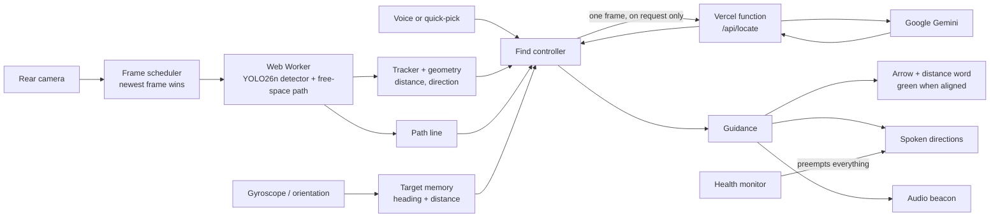

# Kenshi

**A "Find My" for blind and low-vision people.** Say what you are looking for, such as "find the exit", and Kenshi guides you to it with a large arrow, spoken GPS-style directions, and an audio beacon in your AirPods that pulses faster as you get closer. It runs as a website in Safari on an iPhone. There is nothing to install from a store.

> Kenshi **complements the white cane and never replaces it.** It gives hints, not guarantees, and it never tells the user that a path is clear or safe.

---

## Contents

1. [The problem](#the-problem)
2. [What Kenshi does](#what-kenshi-does)
3. [Using it](#using-it)
4. [How it works](#how-it-works)
5. [Safety by design](#safety-by-design)
6. [Privacy](#privacy)
7. [Accessibility](#accessibility)
8. [Technology](#technology)
9. [Engineering quality](#engineering-quality)
10. [Honest status and limits](#honest-status-and-limits)
11. [Run it yourself](#run-it-yourself)
12. [Repository map](#repository-map)
13. [Where to read more](#where-to-read-more)

---

## The problem

A white cane or a guide dog tells a blind person what is *in the way*. It does not tell them where the thing they need *is*. In an unfamiliar building, simple tasks become hard: where is the exit, the elevator, the restroom, an empty chair, the trash can? Today that usually means asking a stranger, or waiting for help.

Existing camera apps for blind users mostly *describe* the scene ("a table, two chairs, a person") or read text aloud. That puts a stream of speech on top of the sounds a blind person already depends on to travel safely, and it still leaves the question "which way do I walk?" unanswered.

## What Kenshi does

Kenshi turns the question around. Instead of listing everything it sees, it answers the one question the user asked.

1. **You name a target.** Say "find the exit", "where is the chair", or "take me to the restroom", or tap a large quick-pick button: Exit, Door, Elevator, Stairs, Restroom sign, Chair, Trash can, Person. The buttons always work, even if speech recognition does not.
2. **Kenshi finds it.** If the target is already in view, it is located right away. If not, Kenshi asks you to turn slowly, takes a picture about every 45 degrees, and checks each picture the moment it is taken, so the search ends as soon as the target appears.
3. **Kenshi remembers where it is.** The target's direction is stored as a compass-free heading from the phone's gyroscope. Guidance keeps working when the target slides out of the camera's view, or when you turn away from it.
4. **Kenshi guides you there:**
   - **A large arrow** on screen that points at the target, with the distance as one big word (*Close*, *Near*, *Far*). The whole screen turns **green** when you are facing the target.
   - **Spoken directions** in plain GPS-style words: "Turn around", "Turn left", "Bear right", "Straight ahead".
   - **An audio beacon** in your headphones: short pulses that speed up as you get closer, pan toward the target, rise in pitch when you are facing it, and change to a low double pulse when the target is behind you. A rising three-note chime marks arrival.
5. **It steers you around things without reading you a list.** An on-device object detector runs silently in the background. It never announces objects. Its job is to help Kenshi find a walking line through open floor; when that line has to bend around something, the only words you hear are "Bear left around the obstacle."

> **Design decision: the detector is deliberately silent.** An earlier version spoke obstacle alerts. We removed that on purpose: constant chatter masks the real-world sounds a blind traveler needs, and a spoken list of objects is not what anyone asked for. Kenshi speaks only to answer a request, give a direction, or warn that it is not working.

## Using it

**Demo form factor:** hold the iPhone **sideways at eye level**, to imitate camera glasses. Glasses are a possible future direction only; no glasses integration exists or is claimed.

| Gesture | What happens |
|---|---|
| **Tap anywhere** | Starts listening for one voice command (`find <target>`, `where is the <target>`, `take me to <target>`, `stop`, `pause`, `resume`, `slower`, `faster`, `help`). A tap that hears nothing does nothing. |
| **Long press** | Cancels a running Find. When nothing is running, it pauses or resumes detection. |
| **Stop button** | Large button at the bottom of the Find screen. |
| **Quick-pick buttons** | Start a Find for Exit, Door, Elevator, Stairs, Restroom sign, Chair, Trash can or Person. |

**Distances are said in words, never meters:** *close* (within about 2 m), *near* (within about 5 m), *far*. "Within reach" is announced at 2 m for stairs, 1.5 m for doors, exits, elevators and restrooms, and 1 m for anything else.

**Restrooms** are handled specially: they are found by their sign or door, and "men's room", "ladies' room", "the gents" and similar phrases are understood and kept apart, so you are not sent to the wrong one.

**Add it to the Home Screen** (Safari, Share menu, *Add to Home Screen*) and it opens full screen like an app.

## How it works

Kenshi has two cooperating halves: a **detector that lives entirely on the phone**, and a **locator that asks a Google Gemini vision model** to find the named target in a picture.



### On the phone (frames never leave the device)

- **Object detection.** A YOLO26n model (the small, fast member of the YOLO family, exported to ONNX at 416 px input; under 10 MB) runs with onnxruntime-web inside a **Web Worker**, using **WebGPU** when available and multi-threaded **WebAssembly** otherwise. Camera frames are processed newest-first: if the detector is busy, old frames are dropped rather than queued, so results are never stale. Detection never touches the main thread, so touch, speech and audio stay responsive.
- **Tracking and geometry.** Detections are followed across frames and confirmed after matching in 2 of 3. Direction (clock position, bearing) comes from the box position and a calibrated field of view. Distance comes from the **ground plane** (the phone's tilt plus the user's eye height tell us where a point on the floor lies), with box size as a fallback.
- **Free-space path line.** From the picture's edges, Kenshi finds a walking line through open floor, steered toward the target. It is drawn over the camera inset and decides when guidance should say "Bear left around the obstacle". It is an image hint with no depth, and it never says the way is clear.
- **Heading and target memory.** The phone's orientation sensors give a heading. The target's bearing, estimated distance and time last seen are stored so guidance continues out of view.

### In the cloud (only when you ask)

- **Locate.** On a Find request the app sends a few downscaled JPEG frames, each tagged with the phone's heading and pitch, to **one** Vercel serverless function (`web/api/locate.ts`). The function calls Gemini, which says which frame shows the target and gives a bounding box. Answers below 0.6 confidence count as *not found*; the app never guesses.
- **Staying on the same object.** With several chairs in view, a naive system would flip between them. Kenshi sticks to the first one it chose: re-checks tell Gemini where the chosen object should be in the frame, answers that point somewhere else are ignored, and the on-device detector takes over tracking once it can see the object.
- **Staying within limits.** Re-checks wait at least 6 s apart (every 3 s once within 3 m), a sweep may have 4 requests in flight, and the app caps itself at 12 requests a minute. When the service is busy or unreachable, Kenshi says so in words and offers a retry.

### The Find state machine

The Find controller is a pure reducer with states *idle, checking, sweeping, sweep-checking, guiding, lost, arrived, not-found, error*. Because it has no side effects, every transition (including the failure paths) is unit-tested without a phone.

## Safety by design

Kenshi is treated as safety-critical, and safety rules override any feature.

- **Silence never means clear.** While healthy, a quiet heartbeat tick plays. If detection degrades (stalled, slow, too dark, phone lowered, camera or audio error), Kenshi says so the moment it starts and repeats the warning until fixed.
- **Health warnings come first.** A warning interrupts all other speech and silences the beacon. Detection keeps running during Find.
- **Never "clear" or "safe".** No phrase in the app says or implies the path is free. A test scans every phrase for such wording.
- **Find results are hints.** When the target isn't found, the app says "I could not find it", never "it is not here".
- **No stale information.** Anything out of date is dropped before it is spoken.
- **Every failure is spoken and shown, with a way to recover** (no network, Gemini busy, timeout, camera or sound blocked, nothing found).
- **The detector is silent.** A test sends frames full of nearby objects through the pipeline and asserts that no announcement is produced.

## Privacy

- **Detection is private by construction:** it runs on the phone and those frames never leave it.
- **Find sends pictures only when you start a Find,** never continuously and never as video. They go to one Vercel function and from there to Google Gemini. The function stores nothing and logs no images or targets.
- **The Gemini API key stays on the server.** It is an environment variable on Vercel, never sent to the browser and never committed.
- **A caveat we state openly:** the project uses Google's free Gemini tier. On that tier Google may use submitted images to improve its products, and human reviewers may read them. A production version would move to a paid tier with data-use protections. For this project, the owner decided not to show an in-app notice.
- There is no account, no analytics, and no other backend.

## Accessibility

Built to be used without looking at the screen:

- Every state change is spoken and also written to an `aria-live` region.
- Works with VoiceOver on or off, in portrait and both landscape orientations, and at large text sizes. Touch targets are at least 60 px.
- Speech is optional: the quick-pick buttons and the large Stop button need no voice recognition at all.
- The arrow animates smoothly, and not at all for users who ask for reduced motion.
- Speed of speech, spoken feedback, and tone and heartbeat volume are adjustable in Settings, stored on the device.

## Technology

| Area | Choice |
|---|---|
| App | React 19, TypeScript, Vite; a website, not a store app |
| On-device vision | YOLO26n (ONNX, 416 px) via onnxruntime-web, in a Web Worker; WebGPU, falling back to multi-threaded WebAssembly |
| Locator | Google Gemini via one Vercel serverless function (`web/api/locate.ts`); default model `gemini-3.1-flash-lite`, configurable |
| Sensors | Device orientation (pitch, roll, heading), rear camera, wake lock |
| Audio | Web Audio (beacon, heartbeat, chime), speech synthesis, speech recognition |
| Hosting | Vercel (static site plus one function), with cross-origin isolation headers for multi-threaded WebAssembly |
| Tooling | Node 22.12+ / 24, `uv` and Python 3.13 for model export only; oxlint, Vitest |

## Engineering quality

- **977 automated tests** cover the pure logic: detector post-processing, geometry, tracking, the free-space path, the Find state machine, guidance wording, voice commands, health transitions, the beacon scheduler, and the Gemini function with its failure paths. The lint, type check, and tests all pass.
- **Pure logic is separated from device code.** State machines and math are pure functions with tests; camera, audio, sensors and network code stay in thin adapters.
- **Every tunable number lives in one file** (`web/src/core/config.ts`), so tuning never means changing logic.
- **Requirements are traceable.** `docs/SRS.md` lists numbered functional, non-functional and safety requirements (FR, NFR, SR), and `docs/SDS.md` maps each to a design and tests.
- **Measured, not guessed.** `?bench` and `?debug` screens measure inference time, frame rate, and capture-to-result latency. Numbers nobody has measured are marked "to be measured" in the docs.

## Honest status and limits

Everything in the feature list above is built and passes its automated checks. What we have **not** yet done is just as important to say:

- **Not yet measured on the demo iPhone:** frame rate, inference time, and Find latency. The desktop benchmark (in `docs/SDS.md` section 4) is within the targets, but a laptop is not an iPhone. The requirements NFR-1 to NFR-7 and NFR-10 are open until phone numbers exist.
- **Phone-only behaviors still need a hands-on field check:** turning accuracy of the stored heading, the arrow tracking while you rotate, audio and speech behavior with AirPods on iOS, VoiceOver reading order, and the path line lining up with the floor in landscape.
- **Gemini's free tier is slow and rate-limited.** Replies take roughly 2 to 6 seconds and can time out at the 8 s limit. The app handles this and tells the user, but it is the weakest link in the experience.
- **Estimates, not measurements.** Distances are within a rough tolerance (target: plus or minus 30%) and are given as *close / near / far* for that reason. The default field of view is an estimate until calibrated on the phone (Settings).
- **iPhone and Safari only.** No Android, no other browsers, no glasses.
- **Needs a network** for Find. There is no offline mode.
- **Not covered, by design:** street crossing and traffic signals, route planning or GPS navigation, and telling stairs up from stairs down. Kenshi guides to one nearby target at a time.

## Run it yourself

You need [Node.js](https://nodejs.org) 22.12 or newer (24 LTS recommended), [uv](https://docs.astral.sh/uv/), and git.

### Web app

Run these **inside `web/`**; the repo root has no `package.json`.

```
cd web
npm install
npm run dev
```

Open http://localhost:5173/. Tap Start to run the camera loop (add `?debug` for the overlay with boxes, direction, distance, tilt, fps, and timings). Settings holds the eye height and the field-of-view calibration; hold the phone sideways. Add `?bench` to the URL for the benchmark screen instead. To test on a phone, run `ngrok http 5173` in a second terminal and open the ngrok address on the phone.

Checks: `npm run lint`, `npm run typecheck`, `npm run test`, `npm run build`.

`npm install` may print `npm warn install-scripts ... protobufjs`. That is a warning only and can be ignored.

### Find (Gemini) setup

Find sends camera frames to Google Gemini through one Vercel function, `web/api/locate.ts`. It needs a Google AI Studio key (https://aistudio.google.com/apikey).

- **Vercel:** in the project's Settings, Environment Variables, add `GEMINI_API_KEY` (your key) and, optionally, `GEMINI_MODEL` (a Gemini model name; the default is `gemini-3.1-flash-lite`, which answered in 2 to 3.5 s in our checks). Redeploy after changing them. The key stays on the server and is never sent to the browser or committed.
- **Locally:** `vercel link` (Root Directory `web`), then put the same names in `web/.env.local` (git ignores it; `web/.env.example` lists them). `npm run dev` does not run the function. Run `npm run dev:api` in `web/` instead: it starts `vercel dev` on port 3000 (the app and `/api/locate`) with `.env.local` loaded, because `vercel dev` alone reads the Vercel project's Development variables and ignores that file.
- **Try it:** `node scripts/try-locate.mjs public/samples/bus.jpg bus http://localhost:3000` prints the status, the time, and the reply. With `?debug` on the app, the Locate panel sends the current camera frame and a typed target and shows the JSON.
- **On a phone:** the ngrok tunnel to `npm run dev` or `vite preview` (ports 5173 and 4173) serves the app only, with no `/api/locate`, so Find and the Locate panel report "No locate function ... on this server". Use the deployed URL, or run `npm run dev:api` and tunnel port 3000 (`ngrok http 3000`).
- **Limits:** the first check and the re-checks while guiding wait at least 6 seconds after the previous call. A sweep sends each 45 degree frame on its own as soon as it is taken, up to 4 at once. All calls together are capped at 12 per minute. The free tier has its own limits, which change; when it is out the app says the search service is busy.

### Python tooling

From the repo root: `uv sync --all-groups`. Export the model with `uv run --group ml python ml/export_onnx.py`. Redraw the Home Screen icons with `uv run --group ml python ml/make_icons.py`. Never commit the Gemini key.

### If something fails

- `ENOENT ... package.json`: you are not in `web/`.
- `EBADENGINE` or "Unsupported engine": upgrade Node (`node --version` must be 22.12 or newer).
- Missing files after a merge: `git switch main && git pull`, then `npm install` again.
- Odd install errors: delete `web/node_modules` and run `npm install` again.

## Repository map

```
web/                      the app (Vite + React + TypeScript)
  api/locate.ts           the one Vercel function: validates input, calls Gemini, keeps the key server-side
  public/models/          YOLO26n ONNX models (320 and 416 px)
  public/manifest.webmanifest, icons/   Home Screen install
  src/core/               shared types and every tunable number (config.ts)
  src/camera/             camera stream, frame scheduler, wake lock
  src/detection/          Web Worker, ONNX engine, pre/post-processing, free-space path stage
  src/sensors/            device orientation, tilt and heading math
  src/geometry/           bearing, clock direction, ground-plane distance, free-space path line
  src/tracking/           tracker, smoothing, time-to-contact
  src/find/               Find controller (state machine), guidance, target memory, locate client, targets and phrases
  src/audio/              speech, tones, heartbeat, audio beacon
  src/voice/              voice commands, recognizer, tap and long-press gestures
  src/health/             health monitor (stalls, low light, phone lowered, errors)
  src/app/                session, pipeline, settings, calibration, and the screens (Find screen, Settings, debug, benchmark)
ml/                       Python scripts to export the model and draw the icons (uv)
docs/                     SRS.md (requirements) and SDS.md (design)
claude/CLAUDE.md          the working rules the AI coding assistant followed
PROGRESS.md               build log, module map and decisions
```

## Where to read more

- [`docs/SRS.md`](docs/SRS.md): what Kenshi must do: numbered functional, non-functional and safety requirements.
- [`docs/SDS.md`](docs/SDS.md): how it does it: architecture, data flow, latency budget, geometry, failure handling, and the Find design.
- [`PROGRESS.md`](PROGRESS.md): the detailed build log, including every decision, its reason, and what remains unchecked on a phone.
