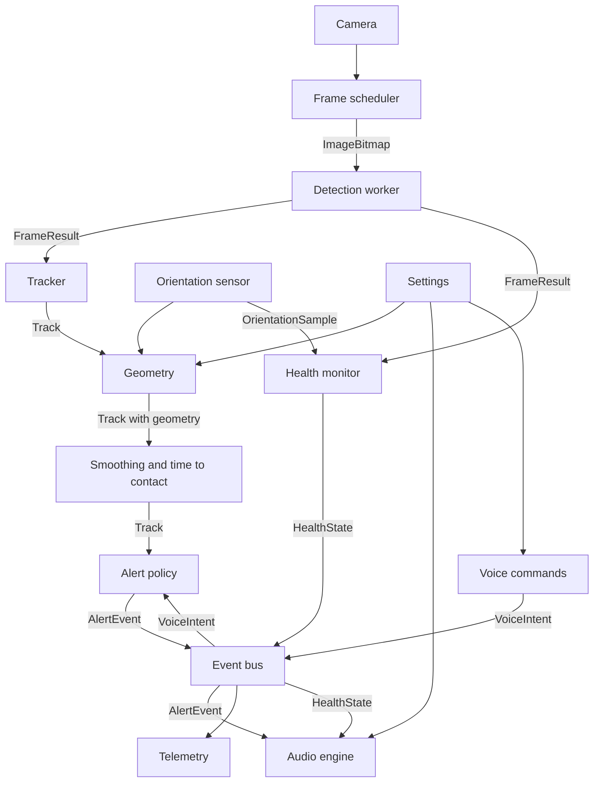

# Software Design Specification: Kenshi

Version 0.1 · How we meet [SRS.md](SRS.md). Type names refer to `web/src/core/types.ts`; tunable numbers to `web/src/core/config.ts` (`CONFIG.<section>.<name>`). Numbers written here are the starting defaults from config.

## 1. Architecture overview

Everything runs in the browser. Heavy work (preprocessing, inference, postprocessing) runs in one Web Worker. Everything else is light and runs on the main thread. Modules talk through typed function calls along the main data path, and through the event bus for alerts, health, voice, settings, and telemetry. `app/session.ts` owns the live run (start, pause, resume, page hide) and `app/pipeline.ts` will wire the tracking, geometry, and alert modules into it as they arrive.



## 2. Modules

Paths are under `web/src/`. Tests sit next to the source as `*.test.ts`. Pure logic is kept in pure functions; adapters (camera, audio, sensors, DOM) stay thin.

### 2.1 Core
- **Path:** `core/types.ts`, `core/config.ts`
- **Responsibility:** shared contracts and every tunable number.
- **Satisfies:** all (indirectly).

### 2.2 Camera
- **Path:** `camera/camera.ts`, `camera/wakeLock.ts`
- **Responsibility:** opens the rear camera at about 1280x720 (`CONFIG.camera`) with no audio, then switches to the plain wide "Back Camera" lens when the device lists one (virtual multi-lens devices can change the field of view on their own); plays it in a muted, inline video element; reports frame-size changes (rotation) and stream loss. `wakeLock.ts` holds the screen awake while running and is re-requested on resume. Failures are typed (`permission-denied`, `no-camera`, `camera-busy`, `insecure-page`, `unknown`), each with one spoken sentence.
- **In → out:** user gesture → a playing video element and `CameraInfo`; errors → `CameraError`.
- **Satisfies:** FR-1, FR-18, SR-8.

### 2.3 Frame scheduler
- **Path:** `camera/scheduler.ts`
- **Responsibility:** latest-frame-wins capture. Driven by `requestVideoFrameCallback` (`requestAnimationFrame` where missing). When the worker is idle and 90% of `1000 / maxFps` ms have passed (`frameGapTolerance`, so camera jitter does not cost a whole frame), grabs one `ImageBitmap` stamped with `captureTimeMs` and transfers it; it also captures again as soon as a detection finishes, because waiting for the next video frame would drop a 30 fps camera to 10 fps when detection takes about 70 ms. If a bitmap cannot be made from the video element it draws to a canvas instead. Never queues.
- **In → out:** video element, worker idle flag → `{frameId, captureTimeMs, bitmap}` to the worker.
- **Satisfies:** FR-1, NFR-1, NFR-12.

### 2.4 Detection worker and engine
- **Path:** `detection/worker.ts` (worker side), `detection/engine.ts` (main-thread client), `detection/protocol.ts` (message types), `detection/preprocess.ts`, `detection/postprocess.ts`, `detection/classes.ts` (generated, exports `ClassInfo[]`). The onnxruntime-web WebAssembly files are copied to `public/ort/` by `web/scripts/copy-ort.mjs` before dev and build and served from our own origin.
- **Responsibility:** load the ONNX model with onnxruntime-web (WebGPU, then WebAssembly), letterbox the frame to `inputSize`, run inference, decode, apply per-class thresholds and class-aware NMS, map boxes back to normalized source-frame coordinates. Also computes `meanLuma`. Keeps only the newest waiting frame. The engine rejects loading with a typed `DetectionLoadError`; restarting the worker after a crash is the orchestrator's job (A2).
- **In → out:** `{frameId, captureTimeMs, bitmap}` → `FrameResult`.
- **Satisfies:** FR-2, NFR-1, NFR-2, NFR-5, NFR-6, NFR-12, NFR-13.

### 2.5 Orientation sensor
- **Path:** `sensors/orientation.ts` (adapter), `sensors/attitude.ts` (pure math)
- **Responsibility:** requests motion permission inside the Start tap (iOS needs a gesture), listens to `deviceorientation` only while running, turns beta and gamma into camera pitch and roll for the current screen angle (landscape either way, or upright; see the comments in `attitude.ts`), smooths them, and keeps one second of history so a frame is paired with the tilt at its capture time (`at(timeMs)`; orientation holds until it changes, so a reading counts for up to `staleAfterMs`). With permission refused, or no reading within `noDataTimeoutMs`, the status is `denied` or `unavailable`: geometry assumes the camera is level and is marked degraded, and the status line says distances are less accurate. Held sideways the angles are well behaved; held upright, roll is noisy near level.
- **In → out:** `DeviceOrientationEvent` → `OrientationSample`; status `idle | waiting | ready | denied | unavailable`.
- **Satisfies:** FR-3, FR-18.

### 2.6 Geometry
- **Path:** `geometry/geometry.ts` (all pure functions: `locate`, `locateDetection`, `cameraModel`, `roundDistance`)
- **Responsibility:** turn a box, the camera tilt, and the eye height and field of view from `Settings` into the clock position, the distance and its method, the height label, and path membership. See section 5.
- **In → out:** `BoundingBox` + `ClassInfo` + frame size + `Tilt | null` + `Settings` → `GeometryResult`: `clock`, `distanceM` (unrounded, for smoothing), `distanceRoundedM` (as spoken), `distanceSource`, `distanceGroundM`, `distanceBoxM`, `elevation`, heights, `lateralOffsetM`, `inPath`, `touchesBottom`, `degraded`. The tracker (A4) copies these onto each `Track`.
- **Satisfies:** FR-6, FR-7, FR-8, FR-9, NFR-7.

### 2.7 Tracker, smoothing, time-to-contact
- **Path:** `tracking/tracker.ts` (matching and confirmation), `tracking/smoothing.ts`, `tracking/timeToContact.ts`
- **Responsibility:** match `Detection`s to tracks, confirm tracks, smooth boxes and distance, estimate `closingSpeedMps`, `timeToContactS`, and `approaching`. See section 6.
- **In → out:** `FrameResult` → `Track[]` (matching); geometry-annotated `Track[]` → `Track[]` with smoothed distance and motion.
- **Satisfies:** FR-4, FR-5, NFR-6.

### 2.8 Alert policy and phrases
- **Path:** `alerts/policy.ts` (decisions), `alerts/phrases.ts` (all spoken text)
- **Responsibility:** choose which tracks become `AlertEvent`s, with priority, cooldowns, and the queue rules in section 7; build phrases in the CLAUDE.md format; hold the summary, help, and health texts. `phrases.ts` is the only place spoken wording lives, so SR-2 can be tested in one file.
- **In → out:** `Track[]`, `HealthState`, `VoiceIntent`, `Settings` → `AlertEvent`.
- **Satisfies:** FR-9, FR-10, FR-11, SR-2, SR-3, SR-4, SR-7, NFR-6.

### 2.9 Event bus
- **Path:** `alerts/bus.ts`
- **Responsibility:** a minimal typed publish/subscribe keyed by `EventMap` (`frame`, `tracks`, `alert`, `alertOutcome`, `health`, `voice`, `settings`, `telemetry`). No other module imports another track's internals.
- **In → out:** `EventMap[K]` in, same payload out to subscribers.
- **Satisfies:** SR-8 (errors travel on it), integration of all tracks.

### 2.10 Audio engine
- **Path:** `audio/unlock.ts`, `audio/tones.ts`, `audio/speech.ts`, `audio/heartbeat.ts`, `audio/engine.ts` (ties them together); `app/audioLink.ts` connects the session, health monitor, and engine; `app/screens/AudioTestPanel.tsx` fires sample alerts under `?debug`
- **Tones:** urgent is `urgentPulseCount` high pulses whose gap shrinks with distance (unknown distance pulses fastest); normal is one mid tone; info one softer low tone; the health warning is two falling tones, centered; the heartbeat is a short soft click. Pan comes from `AlertEvent.pan` (`panFromAngle` maps a horizontal angle to -1..1).
- **Speech:** at most one phrase waiting (the newest wins); urgent cancels and speaks at once; an enhanced local English voice is preferred once `voiceschanged` lists voices; a watchdog ends a phrase whose end event never comes, so the heartbeat cannot stay blocked.
- **Responsibility:** unlock the `AudioContext` and speech on Start; play the panned lead-in tone; speak phrases with `speechSynthesis` at the user's rate; one utterance at a time with urgent preemption; run the heartbeat only while `HealthState.status` is `healthy` and fresh; run the paused reminder. Before speaking, drops any alert past `staleLimitMs` or whose track is gone.
- **In → out:** `AlertEvent`, `HealthState`, `Settings` → sound; emits `alertOutcome` with `AlertOutcome`.
- **Satisfies:** FR-12, FR-13, FR-17, FR-18, SR-1, SR-3, SR-4, SR-9, NFR-3, NFR-4.

### 2.11 Voice commands
- **Path:** `voice/recognizer.ts` (adapter around the browser recognizer), `voice/commands.ts` (pure text → `VoiceIntent`)
- **Responsibility:** on tap, listen up to `listenTimeoutMs`, map text to a `VoiceIntent`; on failure or silence, emit `whats-around` (tap fallback). Long press toggles `pause`/`resume`.
- **In → out:** gesture, microphone → `VoiceIntent`.
- **Satisfies:** FR-15, FR-16, FR-18.

### 2.12 Health monitor
- **Path:** `health/monitor.ts`; `app/audioLink.ts` feeds it frames and the session's latest `OrientationSample`
- **Responsibility:** pure state machine over frame arrivals, fps window, `meanLuma`, pitch, camera, worker, and audio status; produces `HealthState` and the transitions that trigger warnings (immediately on entry, repeated every `warningRepeatMs`, cleared after `recoverAfterMs`).
- **In → out:** `FrameResult`, `OrientationSample`, error signals, clock ticks → `HealthState`.
- **Satisfies:** FR-14, SR-1, SR-5, SR-6, SR-8, NFR-1.

### 2.13 Telemetry
- **Path:** `telemetry/logger.ts`, `telemetry/export.ts`
- **Responsibility:** in Test mode, subscribe to the bus and buffer `TelemetryEvent`s (capped); export as JSON Lines on a user tap. `scripts/replay.ts` reads the same files.
- **In → out:** bus events → `TelemetryEvent`; export → `.jsonl` file.
- **Satisfies:** FR-19, NFR-10 (memory cap); provides the measurements for NFR-1 to NFR-4.

### 2.14 Settings and calibration
- **Path:** `app/settings.ts` (store persisted in `localStorage`, values clamped on load and on change, safe when storage is blocked), `app/useSettings.ts`, `app/calibration.ts` (pure field-of-view math and the written steps), `app/screens/Settings.tsx`, `app/screens/Calibrate.tsx`
- **Responsibility:** hold `Settings` with defaults from config. The Settings screen (a button on the Start screen) sets the eye height and opens the calibration. Calibrate shows the live camera with a vertical center line, the live pitch and roll, and the steps, written and read aloud: stand 1 m from a wall, hold the phone level and sideways at eye level, have a teammate mark the wall at the left and right edges of the view, measure the width, enter it. The field of view is `2·atan(width / 2 / distance)`, rejected outside `minFovDeg`..`maxFovDeg`, and is stored. It is measured for the stream the app actually uses (same camera and size), and applies to the landscape picture.
- **In → out:** user input → `Settings`. Publishing changes on the event bus waits for the bus (S3); for now the store notifies subscribers directly.
- **Satisfies:** FR-17, FR-6, FR-7.

### 2.15 Pipeline orchestrator and screens
- **Path:** `app/session.ts` (start, pause, resume, page hide, shutdown), `app/useSession.ts`, `app/messages.ts`, `app/screens/` (including `DebugOverlay.tsx`, shown with `?debug`), `App.tsx`; `app/pipeline.ts` arrives with tracking and geometry.
- **Responsibility:** per-frame wiring (section 3), Start sequence (wake lock, camera, and model load all start in the Start tap), pause/resume, aria-live status line, large Talk area, first-run text stating the cane is still needed. Landscape-first layout that also works upright.
- **Satisfies:** FR-16, FR-18, NFR-9, NFR-10, NFR-11, NFR-12, SR-7, SR-8.

### 2.16 Offline cache
- **Path:** `web/public/sw.js` (hand-written service worker), registered from `app/pipeline.ts`
- **Responsibility:** cache the app shell, onnxruntime-web files, and the model on first load; serve them offline. Cached responses keep the original cross-origin isolation headers.
- **Satisfies:** NFR-8.

### 2.17 Describe (Stretch, S6)
- **Path:** `app/describe.ts`, `web/api/describe.ts` (one Vercel function; the Claude API key lives only in a Vercel environment variable)
- **Responsibility:** on `describe`, downscale one frame to `CONFIG.describe.maxImageSidePx`, send it, speak the reply as an `info` alert that urgent alerts can preempt. Created in S6; not part of the first build.
- **Satisfies:** FR-20, NFR-9 (the single exception).

## 3. Per-frame data flow

1. **Capture.** The scheduler sees an idle worker and a due frame; stamps `captureTimeMs = performance.now()`; transfers the `ImageBitmap` to the worker. If the worker is busy it skips the frame.
2. **Worker.** Letterbox to `inputSize`, build the tensor, compute `meanLuma`, run inference, decode, threshold per class, unletterbox. Posts a `FrameResult`.
3. **Health.** The monitor records the arrival (fps window, stall timer, light).
4. **Track.** The tracker matches detections to tracks and updates confirmation.
5. **Geometry.** For each track, geometry adds clock, distance, elevation, and `inPath` using the latest `OrientationSample` and `Settings`.
6. **Motion.** Smoothing and time-to-contact set `closingSpeedMps`, `timeToContactS`, `approaching`.
7. **Policy.** The policy turns eligible tracks into `AlertEvent`s and publishes them.
8. **Audio.** The audio engine runs the stale check and track check, plays the tone, then speaks.
9. **Telemetry.** In Test mode, a `frame` entry (with detections and orientation) and `alert` outcomes are logged.

All timestamps use `performance.now()` on the main thread, so every latency is measured from `captureTimeMs`.

## 4. Latency budget

Budget for the **urgent path**, from the capture of the confirming frame, using p95 values. Sums of p95s overstate the real p95, so the margin is conservative.

| Stage | Budget (ms) | Cumulative (ms) | Notes |
|---|---|---|---|
| Capture (frame grab to bitmap) | 30 | 30 | `createImageBitmap` from the video |
| Transfer to worker | 5 | 35 | transferable, no copy |
| Preprocess | 15 | 50 | letterbox and tensor build |
| Inference | 120 | 170 | NFR-2 |
| Postprocess | 10 | 180 | decode, per-class threshold, NMS, scale to the frame |
| Tracking and geometry | 10 | 190 | main thread, pure functions |
| Alert policy | 5 | 195 | |
| Audio start (urgent tone) | 25 | **220** | NFR-3 target 300; margin 80 |
| Tone duration | 120 | 340 | `toneDurationMs` |
| Gap and speech start | 150 | **490** | 80 ms `toneToSpeechGapMs` plus 70 ms for speech to begin; NFR-4 target 600, margin 110 |

### 4.1 Measured on desktop (step A1)

Benchmark screen (`?bench`), production build, 10 warm-up and 50 timed inferences on `bus.jpg`, three runs per configuration; each cell is the range of the three runs, p50 / p95 in ms. Microsoft Edge 155 (Chromium) headless on a Windows 11 laptop (Intel Core Ultra 7 155H, integrated GPU), cross-origin isolated, 4 WebAssembly threads. **These are not iPhone numbers**; Gate A measures those.

| Configuration | Preprocess | Inference | Postprocess | Total (worker) |
|---|---|---|---|---|
| 320, WebGPU | 3.0 to 3.4 / 4.0 to 4.5 | 22.8 to 26.4 / 29.3 to 37.2 | 0.8 to 1.0 / 1.4 to 1.6 | 26.5 to 31.1 / 33.4 to 41.6 |
| 416, WebGPU | 4.7 to 5.0 / 6.0 to 6.5 | 27.0 to 29.5 / 33.8 to 55.1 | 1.5 to 1.6 / 1.9 to 2.9 | 33.5 to 36.0 / 40.0 to 62.6 |
| 320, WebAssembly | 2.3 to 2.8 / 3.1 to 3.9 | 32.0 to 56.6 / 35.4 to 68.4 | 0.5 to 0.9 / 1.0 to 1.3 | 34.9 to 60.6 / 38.4 to 72.4 |
| 416, WebAssembly | 3.7 to 4.2 / 5.1 to 6.0 | 47.9 to 53.1 / 62.0 to 79.1 | 1.0 to 1.3 / 2.6 to 2.9 | 52.8 to 59.1 / 68.1 to 83.7 |

- Model load takes about 1.2 to 1.7 s (WebAssembly) or 1.7 to 2.0 s (WebGPU). The thread hop adds only 0.3 to 0.5 ms (round trip minus worker total).
- On this machine every configuration is within NFR-2 (inference p95 at most 120 ms) and within the preprocess, inference, and postprocess budgets in the table above. Run-to-run spread is large (for example 320 WebAssembly p50 inference 32 to 57 ms), so decide Gate A on repeated iPhone runs, not one.
- The capture, transfer, tracking, and audio rows are not measured yet (A2 and U1).

Notes:
- A track becomes confirmed on its second matched frame, so confirmation adds up to one frame interval (about 125 ms at 8 fps) before this clock starts. NFR-3 and NFR-4 count from the frame that confirms.
- At 8 fps a new frame arrives every 125 ms, so mean inference must stay near 60 to 80 ms for NFR-1 to hold while p95 stays at 120 ms.
- Speech start on iOS is the least predictable stage; the 70 ms allowed for it is an assumption to measure in U1. If it runs longer, the tone-to-speech gap or the tone length must shrink to hold NFR-4.

## 5. Geometry

Implemented in `geometry/geometry.ts`. Notation: frame `W×H` pixels; `f` the focal length in pixels, `f = (W / 2) / tan(hFov / 2)`; `h` the eye height; `pitch` the camera axis angle above the horizon (positive up); `roll` the rotation about the camera axis (positive clockwise as seen from behind the phone).

A pixel `(px, py)` becomes a ray `(u, v) = ((px - W/2) / f, (py - H/2) / f)` (right, down). The roll is taken out by turning the ray clockwise by `roll`: `u' = u cos(roll) - v sin(roll)`, `v' = u sin(roll) + v cos(roll)`. Then, with the camera axis tilted by `pitch`:

```
forward = cos(pitch) + v' * sin(pitch)
down    = v' * cos(pitch) - sin(pitch)
tan(angle below the horizon) = down / forward
bearing = atan2(u', forward)            horizontal angle, positive to the right
```

A ray with `forward <= 0` points backward and is ignored. Edge touching: a box touches an edge when it is within `edgeTouchMargin` (0.02 of the frame) of it.

**Clock position.** `theta` is the bearing of the box center. A box touching only the left edge is **far left**, only the right edge **far right** (touching both fills the view, so the angle decides). Otherwise `|theta| <= clockCenterDeg` (15°) is **12 o'clock**, more to the right is **1**, more to the left **11**. Beyond 15° the position stays 1 or 11 up to the edge of the picture.

**Ground-plane distance** (primary). For a class with `groundContact`, when the box does not touch the bottom edge and its bottom edge points at least `minDepressionDeg` (3°) below the horizon: `D = h / tan(angle below the horizon at the bottom-center point)`. This is the distance ahead (along the forward direction), not the straight-line distance.

**Box-size distance** (fallback). `D = typicalHeightM * f / (box height in pixels)`, for classes with a typical height. It is reliable only if the box touches neither the top nor the bottom edge.

**Nearest visible floor.** `D_min = h / tan(angle below the horizon at the bottom-center of the frame)`. An object cut off by the bottom edge is no farther than this.

**Choosing.** Candidates outside `minValidDistanceM`..`maxValidDistanceM` (0.3 to 10 m) are discarded. Then:
1. No tilt reading (degraded) and a reliable box-size value: use **box-size**, because the ground plane would be a guess.
2. Else a valid ground-plane value: use **ground-plane**.
3. Else, if the box touches the bottom edge: use the nearer of the box-size value and `D_min` (source `box-size` or `min-visible`). Both tend to overestimate for a cut-off object, so this is a limit, not an estimate.
4. Else the box-size value, if any.
5. Otherwise there is no distance (`null`): the object is not in the path and gets no height label.

Both raw candidates are kept in the result for tuning. The distance is smoothed by the tracker, then spoken rounded to the nearest `roundToM` (0.5 m), never below 0.5 m (`roundDistance`).

**Heights.** With `D` known, an edge's height above the floor is `z = h - D * tan(angle below the horizon at that edge)`, for the top and bottom of the box.
- `floor` if the box does not touch the top edge and `z(top) <= floorTopMaxM` (0.5 m): a low object such as a bag on the ground.
- `head` if the box does not touch the bottom edge and `z(bottom)` lies between `headBottomMinM` (1.2 m) and `headBottomMaxM` (2.0 m): something hanging or protruding at face level. A bottom edge above 2.0 m passes over the head and gets no label.
- `body` otherwise, spoken without a suffix.

**Walking-path corridor.** Lateral offset `X = D * tan(theta)` (right is positive). An object is `inPath` if `D <= corridorDepthM` (4 m) and `|X| <= corridorHalfWidthM` (0.5 m); only the box center counts, not its width. Approaching objects use the wider `approachHalfWidthM` (1 m), applied by the tracker.

**Known limits.**
- A cut-off box (touching the bottom edge) is the weak case: an object about 1 m away can read 1.5 m or more. The policy should treat `touchesBottom` as "close".
- Box-size distance assumes the object stands upright and has the class's typical height; a short person or a tall chair is off by that ratio.
- The pitch and roll signs follow the W3C Euler convention and the unit tests, but have not been checked on the demo iPhone: tilt the phone down and the pitch readout must go negative.

## 6. Tracking

- **Matching.** Greedy by descending IoU between each detection and each existing track of the same class; accept when IoU ≥ `matchIou` (0.3). Unmatched detections start `tentative` tracks with a new, never-reused `id`.
- **Confirmation.** A track becomes `confirmed` when it matched in `confirmationHits` (2) of the last `confirmationWindow` (3) frames. Only confirmed tracks can raise alerts. A tentative track is deleted after `tentativeMaxMisses` (2) consecutive misses; a confirmed track after `lostAfterMs` (800 ms) without a match.
- **Smoothing.** Exponential moving average on the box (`boxSmoothing` 0.5) and on distance (`distanceSmoothing` 0.4); confidence is smoothed the same way as the box.
- **Fast confirmation.** A new track nearer than `nearConfirmDistanceM` (2 m) with confidence of at least `nearConfirmConfidence` (0.7) is confirmed on its first frame.
- **Small boxes.** When IoU fails, two boxes with a longer side below `smallBoxMaxSide` (0.12) still match if their centers are within `smallBoxCenterFactor` longer sides.
- **Frame rate.** Smoothing factors are per `smoothingRefMs` (67 ms) and rescaled by the actual time between frames; motion uses timestamps only.
- **Closing speed.** Least-squares slope of smoothed distance over the last `closingSpeedWindowMs` (500 ms, at least `minMotionSamples` samples spanning half the window), then smoothed (`closingSpeedSmoothing` 0.3). Positive means closer. The user's own walking counts: a static obstacle ahead has a positive closing speed.
- **Time-to-contact.** `timeToContactS = distanceM / closingSpeedMps` when `closingSpeedMps >= approachMinSpeedMps` (0.5), else null.
- **Height fallback.** Without a distance, `timeToContactS = 1 / g`, where g is the slope of ln(box height) per second, when g is at least `minHeightGrowthPerS`.
- **Approaching.** `timeToContactS <= approachMaxTtcS` (4 s), the object within the widened corridor (`approachHalfWidthM`), held for `approachHoldMs` (300 ms).

## 7. Alert policy

**Eligibility.** A confirmed track with `alertable` class that is `inPath` or `approaching`, with `distanceM` within `corridorDepthM`.

**Priorities.**
- `urgent`: eligible track that is `inPath` with `distanceM <= urgentDistanceM` (1.5 m) or `timeToContactS <= urgentTtcS` (2 s). Health warnings are also `urgent`.
- `normal`: other eligible tracks.
- `info`: summaries ("what's around me"), help, status confirmations, descriptions.

**Speaking rules.**
- One alert at a time. An `urgent` alert cancels the current speech, plays its tone, and speaks. `normal` and `info` never interrupt.
- Waiting alerts are kept in a queue of at most `maxQueuedAlerts` (2), ordered by priority, then nearest distance. A newer alert for the same track replaces its queued one.
- At least `minGapMs` (800) between spoken alerts, except urgent.

**Cooldowns and re-announcement** (per track).
- First time a track is eligible: announce.
- Escalation to `urgent`: announce immediately, once per escalation; repeat no sooner than `urgentCooldownMs` (2 s).
- Entering a closer distance band (`distanceBandsM` 1.5, 3, 4): announce again after `closerBandCooldownMs` (1.5 s).
- Otherwise unchanged and still eligible: repeat only after `repeatCooldownMs` (10 s).
- A track that was deleted and reappears is a new track and is announced again.

**Stale-drop.** Before speech starts, the audio engine drops an alert if `now - frameTimeMs > staleLimitMs` (1000 ms) or if `trackId` no longer exists. Each drop is reported as `dropped-stale` or `dropped-track-gone`.

**Phrase format.** `<object>, <clock> o'clock, about <meters> meters[, on the floor | , at head height]`.
- Object: `ClassInfo.spokenName`. Clock: "11 o'clock", "12 o'clock", "1 o'clock"; for far positions, "far left" or "far right" replaces "<clock> o'clock".
- Meters: rounded to the nearest 0.5, numerals ("about 1.5 meters"); "1 meter" is singular.
- Suffix only for `floor` and `head`.
- Example: "Backpack, 1 o'clock, about 2 meters, on the floor."

**Other texts** (all in `phrases.ts`, none may contain "clear", "safe", "free", "no obstacles", or similar):
- Summary with items: up to `summaryMaxItems` (3) phrases, nearest first.
- Summary with none: "I don't detect anything right now. I can miss things, so keep using your cane."
- Health warnings, pause and resume confirmations, help, and the paused reminder.

## 8. Threading and scheduling
- **Main thread:** UI, camera, scheduler, orchestrator, tracker, geometry, policy, audio scheduling, speech, voice.
- **Detection worker:** onnxruntime-web session, preprocessing (OffscreenCanvas), inference, postprocessing. Nothing else.
- **Latest frame wins:** the scheduler holds at most one frame in flight. A busy worker means the frame is skipped, never queued. If a result is overdue by `stalledAfterMs`, the engine restarts the worker once and the health monitor reports it.
- **Backends:** try WebGPU; if creation or the first run fails, use WebAssembly. WebAssembly uses multiple threads (up to `maxWasmThreads`) only when `crossOriginIsolated` is true (COOP/COEP headers from Vite and Vercel); otherwise one thread, which the benchmark and health monitor will show as a low frame rate. Forcing WebGPU on a device without it fails with a typed `webgpu-unavailable` error; "auto" falls back to WebAssembly and reports why.
- **Audio path:** tones are scheduled on the `AudioContext` clock, not by timers on the main thread. No inference runs there.

## 9. Failure modes and user response

Every failure is spoken (unless spoken feedback is off), written to the aria-live region, and offers a recovery.

| Failure | Detected by | User-facing response | Recovery |
|---|---|---|---|
| Camera permission denied | camera adapter | "Camera access is needed. Allow it in Safari settings, then press Start." | Start button stays available |
| Camera stream lost (call, lock screen, tab hidden) | stream end event | "Detection stopped." Warning repeats | Restart camera on return; press Start if refused |
| Model fails to load | engine | "Could not load the detector. Check your connection and try again." | Retry button; works offline once cached |
| WebGPU unavailable | engine | Silent switch to WebAssembly; warning only if frame rate drops | Automatic |
| Worker crash or stall | engine, health | "Detection stalled." | One automatic restart, then retry button |
| Low frame rate | health | "Detection is slow." | Repeats until it recovers |
| Low light | health | "Too dark to detect reliably." | Repeats until light improves |
| Phone lowered or raised | health | "Raise the phone to eye level." (or "Lower …" when pointed up) | Clears when pitch is back in range |
| Health warning clears (after `recoverAfterMs` of good readings) | health | "Detection back." once | Heartbeat resumes |
| Orientation sensor denied or missing | sensor | "Distance will be less accurate." (once) | Box-size distance used; re-request on Start |
| Speech output unavailable | audio | Tones keep playing; text shown large on screen | Retry on next tap |
| Audio blocked or route lost (AirPods disconnect, interruption) | audio, health | On-screen warning "Sound is off. Tap the screen to restore it." | Tap resumes the `AudioContext` |
| Speech recognition unavailable, denied, or silent | recognizer | Tap runs "what's around me" | Automatic fallback |
| Frame or alert too old | audio | Alert dropped; logged | Automatic |
| Describe request fails (stretch) | describe | "Could not describe the scene." | Try again |
| Paused | pipeline | "Paused." then a reminder every 15 s | Long press or "resume" |

## 10. Model plan

- **Base model:** YOLO26n (COCO, 80 classes). `ml/export_onnx.py` exports it at 320 and 416 (opset 18, simplified by onnxslim) to `web/public/models/yolo26n-<size>.onnx` (9.8 MB each, under the 15 MB limit). The export used here is **raw**: one output of shape `[1, 4 + 80, N]` (N is 2100 at 320 and 3549 at 416) holding center x, center y, width, and height in input pixels, then one score per class (already between 0 and 1). The graph contains no NMS, so postprocess decodes it, applies per-class thresholds, and runs class-aware NMS (`nmsIou`). An end-to-end NMS-free export also exists and could trim postprocess later, but postprocess already measures under 3 ms (section 4.1).
- **Input size: 416.** Gate A chose 416 (owner decision after running the benchmark on the demo iPhone); `CONFIG.detection.inputSize` is 416 and the app loads `yolo26n-416.onnx`. The rule for this choice was to take 416 only if p95 inference stays at or below 120 ms and the frame rate stays at or above 8 fps, otherwise 320. The iPhone numbers are not recorded in this repository yet; add them to section 4.1. The 320 model stays available for the benchmark and as a fallback if NFR-1 or NFR-2 fail in the field.
- **Class map:** `ml/class_map.json` is the hand-maintained source of truth (per class id: spoken name, typical height, ground contact, alertable). `ml/gen_classes.py` generates `detection/classes.ts` as `ClassInfo[]`. Initial alertable COCO classes: person, bicycle, car, motorcycle, bus, truck, bench, chair, couch, dining table, potted plant, backpack, suitcase, handbag, fire hydrant, parking meter, dog.
- **Retrained hazard model (M2, M3):** the base classes plus stairs, curb, pole, and door. COCO ids 0 to 79 keep their numbers and the new classes take 80 to 83, so the class map stays compatible. It replaces the base model only if it wins on our own field-test labels: better recall on the four new classes, no loss of more than 2 points of in-path recall on the COCO obstacle classes, no more false alerts per minute, and inference still within NFR-2 on the iPhone.
- **M2 training data and tools** (details in `ml/datasets.md`). The retrained model has 84 classes: the 80 COCO ids unchanged, then stairs (80), curb (81), pole (82), door (83); the draft class table is `ml/class_map.hazard.json` and M3 copies it over `ml/class_map.json` before regenerating `classes.ts`. Hazard classes come from Open Images V7 (Stairs, Door, and Street light as "pole") and the Zenodo Accessibility Barriers set (stairs, and steps typed as curb); the kept obstacle classes come from a COCO subset and Argoverse-HD (non-commercial license). Hazard images get the base model's pseudo-labels for the 17 kept classes at confidence 0.5. Training is a Colab notebook (`ml/train_colab.ipynb`): 60 epochs with early stopping from `yolo26n.pt` at 416, then a fixed-size ONNX export in the same raw layout. `ml/compare_models.py` scores both models per class on the validation set (kept classes only on hand-labeled images, to keep the pseudo-labels from favoring the base model) and on our own clips, and flags any kept class that loses more than 3 points of recall. That 3-point flag is a screening rule for M2; the adoption rule above, with the 2-point in-path limit on our field-test labels, still decides M3.
- **Stairs and curb** have no usable typical height, so their distance comes from the ground plane only (or `min-visible`).

## 11. Traceability matrix

Verification methods are the same as in the SRS.

| Requirement | Module | Verification |
|---|---|---|
| FR-1 | Camera, Frame scheduler | Field test |
| FR-2 | Detection worker and engine | Unit test, Field test |
| FR-3 | Orientation sensor | Unit test, Field test |
| FR-4 | Tracker | Unit test, Replay |
| FR-5 | Tracker (time-to-contact) | Unit test, Replay |
| FR-6 | Geometry (clock), Settings | Unit test, Replay |
| FR-7 | Geometry (distance), Settings | Unit test, Replay, Field test |
| FR-8 | Geometry (elevation) | Unit test, Replay |
| FR-9 | Geometry (path), Alert policy | Unit test, Replay |
| FR-10 | Alert policy | Unit test, Replay |
| FR-11 | Alert policy (phrases) | Unit test |
| FR-12 | Audio engine (tones) | Field test, Inspection |
| FR-13 | Audio engine (heartbeat) | Field test, Unit test |
| FR-14 | Health monitor | Unit test, Field test |
| FR-15 | Voice commands | Unit test, Field test |
| FR-16 | Voice commands, Pipeline | Field test |
| FR-17 | Settings and calibration | Unit test, Field test, Inspection |
| FR-18 | Pipeline, Audio engine, Camera, Orientation, Voice | Field test |
| FR-19 | Telemetry | Unit test, Replay, Inspection |
| FR-20 (Stretch) | Describe | Field test, Inspection |
| NFR-1 | Frame scheduler, Detection worker | Field test |
| NFR-2 | Detection worker | Field test |
| NFR-3 | Audio engine, Alert policy | Field test, Replay |
| NFR-4 | Audio engine | Field test |
| NFR-5 | Detection worker, Geometry, Alert policy | Field test, Replay |
| NFR-6 | Tracker, Alert policy | Field test, Replay |
| NFR-7 | Geometry (distance) | Field test |
| NFR-8 | Offline cache | Field test |
| NFR-9 | Pipeline, Describe | Inspection |
| NFR-10 | Pipeline, Telemetry | Field test |
| NFR-11 | Pipeline (screens) | Field test, Inspection |
| NFR-12 | Detection worker, Frame scheduler | Inspection, Field test |
| NFR-13 | Detection worker | Inspection |
| SR-1 | Audio engine (heartbeat), Health monitor | Unit test, Field test |
| SR-2 | Alert policy (phrases) | Unit test, Inspection |
| SR-3 | Audio engine, Alert policy | Unit test, Replay |
| SR-4 | Audio engine, Alert policy | Unit test, Field test |
| SR-5 | Health monitor | Unit test, Field test |
| SR-6 | Health monitor | Unit test, Field test |
| SR-7 | Pipeline (screens), Alert policy (help text) | Inspection |
| SR-8 | Health monitor, Event bus, Pipeline | Unit test, Inspection |
| SR-9 | Audio engine (paused reminder) | Unit test, Field test |

## 12. Uncertain design points
- The default horizontal field of view (65°) is an estimate; calibration on the demo phone replaces it.
- The WebGPU path on the demo iPhone's iOS version is unverified; the WebAssembly fallback is the planned floor.
- The retrained model (M3) must keep the raw `[1, 4 + nc, N]` layout; the worker refuses a model whose class count differs from `classes.ts`.
- Speech recognition with AirPods in transparency mode may change the audio route; the tap fallback covers a failure.
- Speech-start latency on iOS (70 ms in the budget) is optimistic and must be measured.
- Letting a high-confidence in-path object skip the 2-of-3 confirmation was considered for speed and rejected for now, because it risks the false-alert target (NFR-6).
