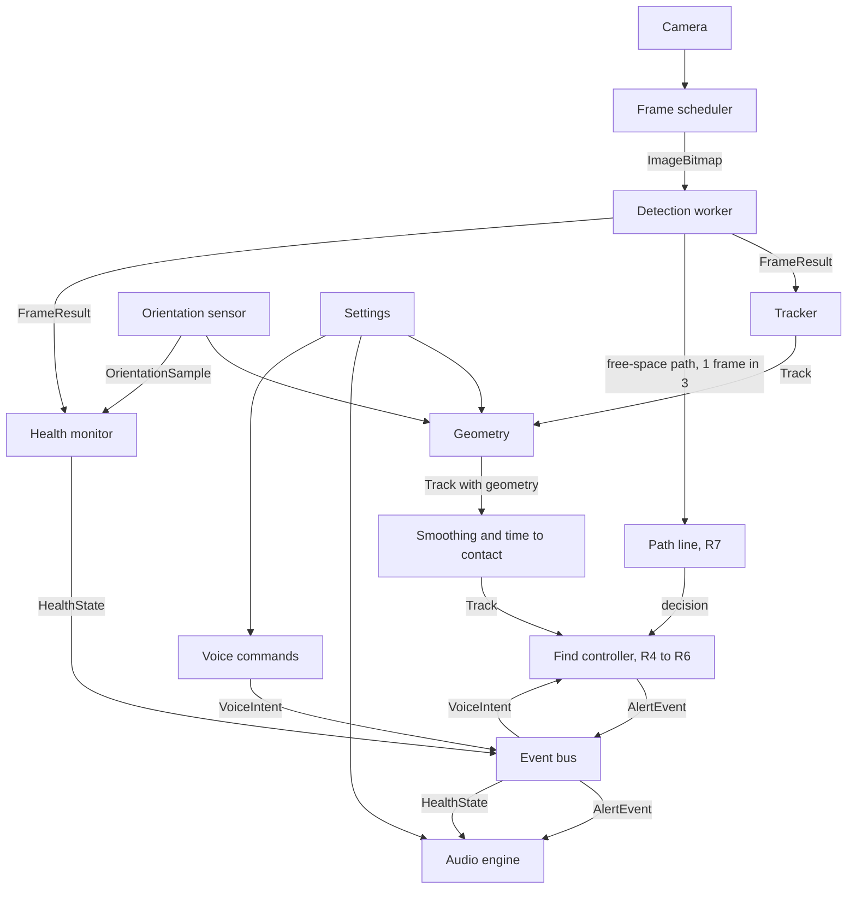
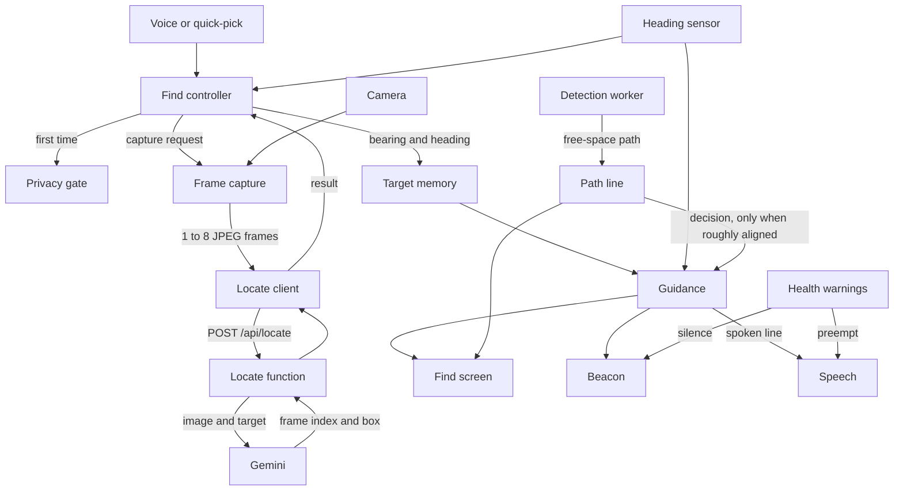

# Software Design Specification: Kenshi

Version 0.3 (silent detector, step P1) · How we meet [SRS.md](SRS.md). Type names refer to `web/src/core/types.ts`; tunable numbers to `web/src/core/config.ts` (`CONFIG.<section>.<name>`). Numbers written here are the starting defaults from config.

## 1. Architecture overview

Detection runs entirely in the browser and never speaks about objects (SR-12); its tracks only shape the route. Find adds one network call to a Vercel function that asks Gemini (section 13). Heavy work (preprocessing, inference, postprocessing) runs in one Web Worker. Everything else is light and runs on the main thread. Modules talk through typed function calls along the main data path, and through the event bus for alerts, health, voice, and settings. `app/session.ts` owns the live run (start, pause, resume, page hide) and `app/pipeline.ts` wires each frame through the tracker, publishes the tracks on the event bus, and connects the audio link.



## 2. Modules

Paths are under `web/src/`. Tests sit next to the source as `*.test.ts`. Pure logic is kept in pure functions; adapters (camera, audio, sensors, DOM) stay thin.

### 2.1 Core
- **Path:** `core/types.ts`, `core/config.ts`
- **Responsibility:** shared contracts and every tunable number.
- **Satisfies:** all (indirectly).

### 2.2 Camera
- **Path:** `camera/camera.ts`, `camera/wakeLock.ts`
- **Responsibility:** opens the rear camera at about 1280x720 (`CONFIG.camera`) with no audio, then switches to the plain wide "Back Camera" lens when the device lists one (virtual multi-lens devices can change the field of view on their own); plays it in a muted, inline video element; reports frame-size changes (rotation) and stream loss. `wakeLock.ts` holds the screen awake while running and is re-requested on resume. Failures are typed (`permission-denied`, `no-camera`, `camera-busy`, `insecure-page`, `unknown`), each with one spoken sentence.
- **In → out:** user gesture → a playing video element and `CameraInfo`; errors → `CameraError`.
- **Satisfies:** FR-1, FR-18, SR-8.

### 2.3 Frame scheduler
- **Path:** `camera/scheduler.ts`
- **Responsibility:** latest-frame-wins capture. Driven by `requestVideoFrameCallback` (`requestAnimationFrame` where missing). When the worker is idle and 90% of `1000 / maxFps` ms have passed (`frameGapTolerance`, so camera jitter does not cost a whole frame), grabs one `ImageBitmap` stamped with `captureTimeMs` and transfers it; it also captures again as soon as a detection finishes, because waiting for the next video frame would drop a 30 fps camera to 10 fps when detection takes about 70 ms. If a bitmap cannot be made from the video element it draws to a canvas instead. Never queues.
- **In → out:** video element, worker idle flag → `{frameId, captureTimeMs, bitmap}` to the worker.
- **Satisfies:** FR-1, NFR-1, NFR-12.

### 2.4 Detection worker and engine
- **Path:** `detection/worker.ts` (worker side), `detection/engine.ts` (main-thread client), `detection/protocol.ts` (message types), `detection/preprocess.ts`, `detection/postprocess.ts`, `detection/classes.ts` (generated, exports `ClassInfo[]`). The onnxruntime-web WebAssembly files are copied to `public/ort/` by `web/scripts/copy-ort.mjs` before dev and build and served from our own origin.
- **Responsibility:** load the ONNX model with onnxruntime-web (WebGPU, then WebAssembly), letterbox the frame to `inputSize`, run inference, decode, apply per-class thresholds and class-aware NMS, map boxes back to normalized source-frame coordinates. Also computes `meanLuma`. Keeps only the newest waiting frame. The engine rejects loading with a typed `DetectionLoadError`; restarting the worker after a crash is the orchestrator's job (A2).
- **In → out:** `{frameId, captureTimeMs, bitmap}` → `FrameResult`.
- **Satisfies:** FR-2, NFR-1, NFR-2, NFR-5, NFR-6, NFR-12, NFR-13.

### 2.5 Orientation sensor
- **Path:** `sensors/orientation.ts` (adapter), `sensors/attitude.ts` and `sensors/heading.ts` (pure math)
- **Responsibility:** requests motion permission inside the Start tap (iOS needs a gesture), listens to `deviceorientation` only while running, turns beta and gamma into camera pitch and roll for the current screen angle (landscape either way, or upright; see the comments in `attitude.ts`), smooths them, and keeps one second of history so a frame is paired with the tilt at its capture time (`at(timeMs)`; orientation holds until it changes, so a reading counts for up to `staleAfterMs`). With permission refused, or no reading within `noDataTimeoutMs`, the status is `denied` or `unavailable`: geometry assumes the camera is level and is marked degraded, and the status line says distances are less accurate. Held sideways the angles are well behaved; held upright, roll is noisy near level.
- **Heading (R3):** the same listener also reads alpha. `heading.ts` builds the rear camera's forward vector in Earth coordinates from alpha, beta and gamma (the device -z axis; east, north, up) and takes `heading = atan2(east, north)` in degrees, compass-style, so turning right raises it. Pitch is `asin(up part)` of the same vector, so pitch and heading share one source of truth. The camera axis is fixed to the device, so portrait and both landscapes need no special cases, and tilting up or down does not move the heading. `HeadingTracker` unwraps the heading (no jump at north; four turns add 1440) and smooths it lightly (`CONFIG.orientation.headingSmoothing`). Past `headingMaxPitchDeg` (75) up or down, the direction on the ground is undefined and the last heading is held. iOS alpha has an arbitrary zero, so only differences are used; `webkitCompassHeading` is not used. The heading rides on `OrientationSample.headingDeg`, so a frame is paired with its heading at capture time exactly like its tilt.
- **In → out:** `DeviceOrientationEvent` → `OrientationSample` (`pitchDeg`, `rollDeg`, `headingDeg`); status `idle | waiting | ready | denied | unavailable`.
- **Satisfies:** FR-3, FR-18.

### 2.6 Geometry
- **Path:** `geometry/geometry.ts` (all pure functions: `locate`, `locateDetection`, `cameraModel`, `roundDistance`)
- **Responsibility:** turn a box, the camera tilt, and the eye height and field of view from `Settings` into the clock position, the distance and its method, the height label, and path membership. See section 5.
- **In → out:** `BoundingBox` + `ClassInfo` + frame size + `Tilt | null` + `Settings` → `GeometryResult`: `clock`, `distanceM` (unrounded, for smoothing), `distanceRoundedM` (as spoken), `distanceSource`, `distanceGroundM`, `distanceBoxM`, `elevation`, heights, `lateralOffsetM`, `inPath`, `touchesBottom`, `degraded`. The tracker (A4) copies these onto each `Track`.
- **Satisfies:** FR-6, FR-7, FR-8, FR-9, NFR-7.

### 2.7 Tracker, smoothing, time-to-contact
- **Path:** `tracking/tracker.ts` (matching and confirmation), `tracking/smoothing.ts`, `tracking/timeToContact.ts`
- **Responsibility:** match `Detection`s to tracks, confirm tracks, smooth boxes and distance, estimate `closingSpeedMps`, `timeToContactS`, and `approaching`. See section 6.
- **In → out:** `FrameResult` → `Track[]` (matching); geometry-annotated `Track[]` → `Track[]` with smoothed distance and motion.
- **Satisfies:** FR-4, FR-5, NFR-6.

### 2.8 Alert policy and phrases (removed)
- Removed in step P1. `alerts/policy.ts` and `alerts/phrases.ts` chose and worded spoken obstacle alerts and the "what's around me" answer. The detector is now silent (SR-12): tracks go on the bus (`tracks`) and feed the path line (R7), and nothing turns them into speech. `alerts/bus.ts` and `alerts/wording.test.ts` (the SR-2 word check) stay in the `alerts/` folder.
- **Satisfies:** SR-2, SR-12.

### 2.9 Event bus
- **Path:** `alerts/bus.ts`
- **Responsibility:** a minimal typed publish/subscribe keyed by `EventMap` (`frame`, `tracks`, `alert`, `alertOutcome`, `health`, `voice`, `settings`). A listener that throws is reported (`console.error`) and does not stop the others. No other module imports another track's internals. The pipeline publishes `frame`, `tracks`, `alert`, `alertOutcome`, `health`, and `voice`. Find mode adds its own topics in step R4.
- **In → out:** `EventMap[K]` in, same payload out to subscribers.
- **Satisfies:** SR-8 (errors travel on it), integration of all tracks.

### 2.10 Audio engine
- **Path:** `audio/unlock.ts`, `audio/tones.ts`, `audio/speech.ts`, `audio/heartbeat.ts`, `audio/engine.ts` (ties them together); `app/audioLink.ts` connects the session, health monitor, and engine; `app/screens/AudioTestPanel.tsx` fires sample alerts under `?debug`
- **Tones:** urgent is `urgentPulseCount` high pulses whose gap shrinks with distance (unknown distance pulses fastest); normal is one mid tone; info one softer low tone; the health warning is two falling tones, centered; the heartbeat is a short soft click. Pan comes from `AlertEvent.pan` (`panFromAngle` maps a horizontal angle to -1..1).
- **Speech:** at most one phrase waiting (the newest wins); urgent cancels and speaks at once; an enhanced local English voice is preferred once `voiceschanged` lists voices; a watchdog ends a phrase whose end event never comes, so the heartbeat cannot stay blocked.
- **Responsibility:** unlock the `AudioContext` and speech on Start; play the panned lead-in tone; speak phrases with `speechSynthesis` at the user's rate; one utterance at a time with urgent preemption; run the heartbeat only while `HealthState.status` is `healthy` and fresh; run the paused reminder. Before speaking, drops any alert past `staleLimitMs` or whose track is gone.
- **In → out:** `AlertEvent`, `HealthState`, `Settings` → sound; emits `alertOutcome` with `AlertOutcome`.
- **Satisfies:** FR-13, FR-17, FR-18, SR-1, SR-3, SR-4, SR-9.

### 2.11 Voice commands
- **Path:** `voice/recognizer.ts` (adapter around the browser recognizer), `voice/commands.ts` (pure text → `VoiceIntent`)
- **Responsibility:** on tap, listen up to `listenTimeoutMs`, map text to a `VoiceIntent`; on failure say once that voice is unavailable; on silence do nothing. There is no command that lists objects. Long press toggles `pause`/`resume`.
- **In → out:** gesture, microphone → `VoiceIntent`.
- **Satisfies:** FR-15, FR-16, FR-18.

### 2.12 Health monitor
- **Path:** `health/monitor.ts`; `app/audioLink.ts` feeds it frames and the session's latest `OrientationSample`
- **Responsibility:** pure state machine over frame arrivals, fps window, `meanLuma`, pitch, camera, worker, and audio status; produces `HealthState` and the transitions that trigger warnings (immediately on entry, repeated every `warningRepeatMs`, cleared after `recoverAfterMs`).
- **In → out:** `FrameResult`, `OrientationSample`, error signals, clock ticks → `HealthState`.
- **Satisfies:** FR-14, SR-1, SR-5, SR-6, SR-8, NFR-1.

### 2.13 Telemetry (removed)
- **Removed in step R0** with the field-test rounds: `telemetry/` (logger, export, session metadata, replay engine, simulated walk), `app/useTelemetry.ts`, the Test mode setting and overlay, the Save test log button, `scripts/replay.ts`, `scripts/make-fixture.ts`, `ml/eval_walks.py`, `field-tests/`, and the `telemetry` topic on the event bus. FR-19 is marked removed in the SRS.

### 2.14 Settings and calibration
- **Path:** `app/settings.ts` (store persisted in `localStorage`, values clamped on load and on change, safe when storage is blocked), `app/useSettings.ts`, `app/calibration.ts` (pure field-of-view math and the written steps), `app/screens/Settings.tsx`, `app/screens/Calibrate.tsx`
- **Responsibility:** hold `Settings` with defaults from config. The Settings screen (a button on the Start screen) sets the eye height and opens the calibration. Calibrate shows the live camera with a vertical center line, the live pitch and roll, and the steps, written and read aloud: stand 1 m from a wall, hold the phone level and sideways at eye level, have a teammate mark the wall at the left and right edges of the view, measure the width, enter it. The field of view is `2·atan(width / 2 / distance)`, rejected outside `minFovDeg`..`maxFovDeg`, and is stored. It is measured for the stream the app actually uses (same camera and size), and applies to the landscape picture.
- **In → out:** user input → `Settings`. Publishing changes on the event bus waits for the bus (S3); for now the store notifies subscribers directly.
- **Satisfies:** FR-17, FR-6, FR-7.

### 2.15 Pipeline orchestrator and screens
- **Path:** `app/session.ts` (start, pause, resume, page hide, shutdown; a pause keeps the camera stream and resume plays it again, so iOS does not ask for the camera again; the lens used last time is remembered and opened directly), `app/useSession.ts`, `app/messages.ts`, `app/pipeline.ts` and `app/usePipeline.ts` (tracker, event bus, audio link), `app/screens/` (including `DebugOverlay.tsx`, shown with `?debug`, which draws the pipeline's tracks), `App.tsx`.
- **Responsibility:** per-frame wiring (section 3), Start sequence (wake lock, camera, and model load all start in the Start tap), pause/resume, aria-live status line, large Talk area. Landscape-first layout that also works upright.
- **Satisfies:** FR-16, FR-18, NFR-9, NFR-10, NFR-11, NFR-12, SR-8, SR-12.

### 2.16 Offline cache (removed)
- Never built. NFR-8 is removed: the app has no service worker, and Find needs a network. Home Screen install (FR-29, step R1) uses a manifest and icons only.

### 2.17 Describe (removed)
- The stretch "describe" command and `web/api/describe.ts` were dropped. Find mode (section 13) replaces them as the only feature that sends frames off the phone.

### 2.18 Find mode modules
- Planned in steps R1 to R7; components, data flow, state machine, and latency budget are in section 13. They reuse the camera, orientation, geometry, tracker, event bus, tones, speech, voice, and health modules (see PROGRESS.md).

## 3. Per-frame data flow

1. **Capture.** The scheduler sees an idle worker and a due frame; stamps `captureTimeMs = performance.now()`; transfers the `ImageBitmap` to the worker. If the worker is busy it skips the frame.
2. **Worker.** Letterbox to `inputSize`, build the tensor, compute `meanLuma`, run inference, decode, threshold per class, unletterbox. Posts a `FrameResult`.
3. **Health.** The monitor records the arrival (fps window, stall timer, light).
4. **Track.** The tracker matches detections to tracks and updates confirmation.
5. **Geometry.** For each track, geometry adds clock, distance, elevation, and `inPath` using the latest `OrientationSample` and `Settings`.
6. **Motion.** Smoothing and time-to-contact set `closingSpeedMps`, `timeToContactS`, `approaching`.
7. **Publish.** The pipeline publishes `frame` and `tracks` on the bus, and `path` when the frame carried a free-space path. Nothing speaks about the tracks; the path line (R7) does not use them.
8. **Audio.** Alerts that other modules put on the bus (Find guidance, health) go to the audio engine, which runs the stale check and track check, plays the tone, then speaks.

All timestamps use `performance.now()` on the main thread, so every latency is measured from `captureTimeMs`.

## 4. Latency budget

Budget for the **detection path**, from the capture of a frame to its tracks, using p95 values. Sums of p95s overstate the real p95, so the margin is conservative. The alert stages (policy, tone, speech) were removed in step P1 along with NFR-3 and NFR-4.

| Stage | Budget (ms) | Cumulative (ms) | Notes |
|---|---|---|---|
| Capture (frame grab to bitmap) | 30 | 30 | `createImageBitmap` from the video |
| Transfer to worker | 5 | 35 | transferable, no copy |
| Preprocess | 15 | 50 | letterbox and tensor build |
| Inference | 120 | 170 | NFR-2 |
| Postprocess | 10 | 180 | decode, per-class threshold, NMS, scale to the frame |
| Tracking and geometry | 10 | **190** | main thread, pure functions |
| Free-space path (R7) | not in the 190 | | worker, on one frame in three (`CONFIG.freeSpace.everyNthFrame`), 320 px wide; measured in 4.2 |

### 4.2 The free-space path (step R7)

The path stage runs in the detection worker after the detections, on one frame in three, so it adds to those frames' worker time and to the round trip. Measured on the same desktop as 4.1 (not an iPhone):

- The pure function on a 320 x 180 frame (a landscape camera frame at `processWidth` 320), Node, synthetic frames from smooth to noisy: p50 about 5 ms, p95 8 to 12 ms.
- The `?bench` screen now has a "Path" row and a "Total with path on 1 frame in 3" row (path forced on every frame, then added to one in three). Its sample image `bus.jpg` is a **portrait** picture, so it is analysed at 320 x 427, which costs about six times as much (Node: p50 30 to 34 ms); the same run in the Edge worker gave about 55 ms p50, 60 ms p95, and a "Total with path on 1 frame in 3" p95 of about 183 ms against about 129 ms without it. That is the bench image's shape, not the live shape.
- The decision rule: if detection p95 on the iPhone goes past the 4 budget with the path on, set `CONFIG.freeSpace.everyNthFrame` to 5 (one line), and only then consider a second worker. **Not yet measured on the iPhone**; the Gate A style run (`?bench`, then `?debug` fps while Find runs) decides.

### 4.1 Measured on desktop (step A1)

Benchmark screen (`?bench`), production build, 10 warm-up and 50 timed inferences on `bus.jpg`, three runs per configuration; each cell is the range of the three runs, p50 / p95 in ms. Microsoft Edge 155 (Chromium) headless on a Windows 11 laptop (Intel Core Ultra 7 155H, integrated GPU), cross-origin isolated, 4 WebAssembly threads. **These are not iPhone numbers**; Gate A measures those.

| Configuration | Preprocess | Inference | Postprocess | Total (worker) |
|---|---|---|---|---|
| 320, WebGPU | 3.0 to 3.4 / 4.0 to 4.5 | 22.8 to 26.4 / 29.3 to 37.2 | 0.8 to 1.0 / 1.4 to 1.6 | 26.5 to 31.1 / 33.4 to 41.6 |
| 416, WebGPU | 4.7 to 5.0 / 6.0 to 6.5 | 27.0 to 29.5 / 33.8 to 55.1 | 1.5 to 1.6 / 1.9 to 2.9 | 33.5 to 36.0 / 40.0 to 62.6 |
| 320, WebAssembly | 2.3 to 2.8 / 3.1 to 3.9 | 32.0 to 56.6 / 35.4 to 68.4 | 0.5 to 0.9 / 1.0 to 1.3 | 34.9 to 60.6 / 38.4 to 72.4 |
| 416, WebAssembly | 3.7 to 4.2 / 5.1 to 6.0 | 47.9 to 53.1 / 62.0 to 79.1 | 1.0 to 1.3 / 2.6 to 2.9 | 52.8 to 59.1 / 68.1 to 83.7 |

- Model load takes about 1.2 to 1.7 s (WebAssembly) or 1.7 to 2.0 s (WebGPU). The thread hop adds only 0.3 to 0.5 ms (round trip minus worker total).
- On this machine every configuration is within NFR-2 (inference p95 at most 120 ms) and within the preprocess, inference, and postprocess budgets in the table above. Run-to-run spread is large (for example 320 WebAssembly p50 inference 32 to 57 ms), so decide Gate A on repeated iPhone runs, not one.
- The capture, transfer, tracking, and audio rows are not measured yet (A2 and U1).

Notes:
- A track becomes confirmed on its second matched frame, so confirmation adds up to one frame interval (about 125 ms at 8 fps) before this clock starts. NFR-3 and NFR-4 count from the frame that confirms.
- At 8 fps a new frame arrives every 125 ms, so mean inference must stay near 60 to 80 ms for NFR-1 to hold while p95 stays at 120 ms.
- Speech start on iOS is the least predictable stage; the 70 ms allowed for it is an assumption to measure in U1. If it runs longer, the tone-to-speech gap or the tone length must shrink to hold NFR-4.

## 5. Geometry

Implemented in `geometry/geometry.ts`. Notation: frame `W×H` pixels; `f` the focal length in pixels, `f = (W / 2) / tan(hFov / 2)`; `h` the eye height; `pitch` the camera axis angle above the horizon (positive up); `roll` the rotation about the camera axis (positive clockwise as seen from behind the phone).

A pixel `(px, py)` becomes a ray `(u, v) = ((px - W/2) / f, (py - H/2) / f)` (right, down). The roll is taken out by turning the ray clockwise by `roll`: `u' = u cos(roll) - v sin(roll)`, `v' = u sin(roll) + v cos(roll)`. Then, with the camera axis tilted by `pitch`:

```
forward = cos(pitch) + v' * sin(pitch)
down    = v' * cos(pitch) - sin(pitch)
tan(angle below the horizon) = down / forward
bearing = atan2(u', forward)            horizontal angle, positive to the right
```

A ray with `forward <= 0` points backward and is ignored. Edge touching: a box touches an edge when it is within `edgeTouchMargin` (0.02 of the frame) of it.

**Clock position.** `theta` is the bearing of the box center. A box touching only the left edge is **far left**, only the right edge **far right** (touching both fills the view, so the angle decides). Otherwise `|theta| <= clockCenterDeg` (15°) is **12 o'clock**, more to the right is **1**, more to the left **11**. Beyond 15° the position stays 1 or 11 up to the edge of the picture.

**Ground-plane distance** (primary). For a class with `groundContact`, when the box does not touch the bottom edge and its bottom edge points at least `minDepressionDeg` (3°) below the horizon: `D = h / tan(angle below the horizon at the bottom-center point)`. This is the distance ahead (along the forward direction), not the straight-line distance.

**Box-size distance** (fallback). `D = typicalHeightM * f / (box height in pixels)`, for classes with a typical height. It is reliable only if the box touches neither the top nor the bottom edge.

**Nearest visible floor.** `D_min = h / tan(angle below the horizon at the bottom-center of the frame)`. An object cut off by the bottom edge is no farther than this.

**Choosing.** Candidates outside `minValidDistanceM`..`maxValidDistanceM` (0.3 to 10 m) are discarded. Then:
1. No tilt reading (degraded) and a reliable box-size value: use **box-size**, because the ground plane would be a guess.
2. Else a valid ground-plane value: use **ground-plane**.
3. Else, if the box touches the bottom edge: use the nearer of the box-size value and `D_min` (source `box-size` or `min-visible`). Both tend to overestimate for a cut-off object, so this is a limit, not an estimate.
4. Else the box-size value, if any.
5. Otherwise there is no distance (`null`): the object is not in the path and gets no height label.

Both raw candidates are kept in the result for tuning. The distance is smoothed by the tracker, then spoken rounded to the nearest `roundToM` (0.5 m), never below 0.5 m (`roundDistance`).

**Heights.** With `D` known, an edge's height above the floor is `z = h - D * tan(angle below the horizon at that edge)`, for the top and bottom of the box.
- `floor` if the box does not touch the top edge and `z(top) <= floorTopMaxM` (0.5 m): a low object such as a bag on the ground.
- `head` if the box does not touch the bottom edge and `z(bottom)` lies between `headBottomMinM` (1.2 m) and `headBottomMaxM` (2.0 m): something hanging or protruding at face level. A bottom edge above 2.0 m passes over the head and gets no label.
- `body` otherwise, spoken without a suffix.

**Walking-path corridor.** Lateral offset `X = D * tan(theta)` (right is positive). An object is `inPath` if `D <= corridorDepthM` (4 m) and `|X| <= corridorHalfWidthM` (0.5 m); only the box center counts, not its width. Approaching objects use the wider `approachHalfWidthM` (1 m), applied by the tracker.

**Known limits.**
- A cut-off box (touching the bottom edge) is the weak case: an object about 1 m away can read 1.5 m or more. The path line (R7) should treat `touchesBottom` as "close".
- Box-size distance assumes the object stands upright and has the class's typical height; a short person or a tall chair is off by that ratio.
- The pitch and roll signs follow the W3C Euler convention and the unit tests, but have not been checked on the demo iPhone: tilt the phone down and the pitch readout must go negative.

## 6. Tracking

- **Matching.** Greedy by descending IoU between each detection and each existing track of the same class; accept when IoU ≥ `matchIou` (0.3). Unmatched detections start `tentative` tracks with a new, never-reused `id`.
- **Confirmation.** A track becomes `confirmed` when it matched in `confirmationHits` (2) of the last `confirmationWindow` (3) frames. Only confirmed tracks can raise alerts. A tentative track is deleted after `tentativeMaxMisses` (2) consecutive misses; a confirmed track after `lostAfterMs` (800 ms) without a match.
- **Smoothing.** Exponential moving average on the box (`boxSmoothing` 0.5) and on distance (`distanceSmoothing` 0.4); confidence is smoothed the same way as the box.
- **Fast confirmation.** A new track nearer than `nearConfirmDistanceM` (2 m) with confidence of at least `nearConfirmConfidence` (0.7) is confirmed on its first frame.
- **Small boxes.** When IoU fails, two boxes with a longer side below `smallBoxMaxSide` (0.12) still match if their centers are within `smallBoxCenterFactor` longer sides.
- **Frame rate.** Smoothing factors are per `smoothingRefMs` (67 ms) and rescaled by the actual time between frames; motion uses timestamps only.
- **Closing speed.** Least-squares slope of smoothed distance over the last `closingSpeedWindowMs` (500 ms, at least `minMotionSamples` samples spanning half the window), then smoothed (`closingSpeedSmoothing` 0.3). Positive means closer. The user's own walking counts: a static obstacle ahead has a positive closing speed.
- **Time-to-contact.** `timeToContactS = distanceM / closingSpeedMps` when `closingSpeedMps >= approachMinSpeedMps` (0.5), else null.
- **Height fallback.** Without a distance, `timeToContactS = 1 / g`, where g is the slope of ln(box height) per second, when g is at least `minHeightGrowthPerS`.
- **Approaching.** `timeToContactS <= approachMaxTtcS` (4 s), the object within the widened corridor (`approachHalfWidthM`), held for `approachHoldMs` (300 ms).

## 7. Alert policy (removed)

Removed in step P1. The detector no longer announces objects: there is no alert policy, no object phrase format, no "what's around me", and no tone per object (SR-12). What stays from the old design: the stale check and the track check in the audio engine (SR-3), which Find alerts also use, and the health warnings, which are the only urgent alerts left (SR-4).

The route is how objects are handled. The path line (section 13, step R7) finds the open floor in the picture from its edges and bends the walking line through it toward the target, and guidance (R5) turns its decision into "Bear left around the obstacle" while the target is straight ahead. The user hears only "Turn right a little", never what is in the way.

## 8. Threading and scheduling
- **Main thread:** UI, camera, scheduler, orchestrator, tracker, geometry, audio scheduling, speech, voice.
- **Detection worker:** onnxruntime-web session, preprocessing (OffscreenCanvas), inference, postprocessing. Nothing else.
- **Latest frame wins:** the scheduler holds at most one frame in flight. A busy worker means the frame is skipped, never queued. If a result is overdue by `stalledAfterMs`, the engine restarts the worker once and the health monitor reports it.
- **Backends:** try WebGPU; if creation or the first run fails, use WebAssembly. WebAssembly uses multiple threads (up to `maxWasmThreads`) only when `crossOriginIsolated` is true (COOP/COEP headers from Vite and Vercel); otherwise one thread, which the benchmark and health monitor will show as a low frame rate. Forcing WebGPU on a device without it fails with a typed `webgpu-unavailable` error; "auto" falls back to WebAssembly and reports why.
- **Audio path:** tones are scheduled on the `AudioContext` clock, not by timers on the main thread. No inference runs there.

## 9. Failure modes and user response

Every failure is spoken (unless spoken feedback is off), written to the aria-live region, and offers a recovery.

| Failure | Detected by | User-facing response | Recovery |
|---|---|---|---|
| Camera permission denied | camera adapter | "Camera access is needed. Allow it in Safari settings, then press Start." | Start button stays available |
| Camera stream lost (call, lock screen, tab hidden) | stream end event | "Detection stopped." Warning repeats | Restart camera on return; press Start if refused |
| Model fails to load | engine | "Could not load the detector. Check your connection and try again." | Retry button; works offline once cached |
| WebGPU unavailable | engine | Silent switch to WebAssembly; warning only if frame rate drops | Automatic |
| Worker crash or stall | engine, health | "Detection stalled." | One automatic restart, then retry button |
| Low frame rate | health | "Detection is slow." | Repeats until it recovers |
| Low light | health | "Too dark to detect reliably." | Repeats until light improves |
| Phone lowered or raised | health | "Raise the phone to eye level." (or "Lower …" when pointed up) | Clears when pitch is back in range |
| Health warning clears (after `recoverAfterMs` of good readings) | health | "Detection back." once | Heartbeat resumes |
| Orientation sensor denied or missing | sensor | "Distance will be less accurate." (once) | Box-size distance used; re-request on Start |
| Speech output unavailable | audio | Tones keep playing; text shown large on screen | Retry on next tap |
| Audio blocked or route lost (AirPods disconnect, interruption) | audio, health | On-screen warning "Sound is off. Tap the screen to restore it." | Tap resumes the `AudioContext` |
| Speech recognition unavailable or denied | recognizer | "Voice commands are not available on this device." (once); silence does nothing | Long press still pauses; Find by quick-pick list |
| Frame or alert too old | audio | Alert dropped; logged | Automatic |
| Find has no network | locate client | "I can't reach the internet, so I can't search." | Try again; detection keeps running |
| Gemini rate limit or server error | locate function | "The search service is busy. Try again in a moment." | Try again; offer a retry after a pause |
| Find request times out | locate client | "The search took too long." | Try again |
| Target not found | locate result | "I could not find it." (never "it is not here") | Offer the scan sweep, or another target |
| Heading unavailable (no motion permission) | heading sensor | "I can't tell which way you turn, so I can only search what the camera sees." | Single-frame search only |
| Paused | pipeline | "Paused." then a reminder every 15 s | Long press or "resume" |

## 10. Model plan

- **Base model:** YOLO26n (COCO, 80 classes). `ml/export_onnx.py` exports it at 320 and 416 (opset 18, simplified by onnxslim) to `web/public/models/yolo26n-<size>.onnx` (9.8 MB each, under the 15 MB limit). The export used here is **raw**: one output of shape `[1, 4 + 80, N]` (N is 2100 at 320 and 3549 at 416) holding center x, center y, width, and height in input pixels, then one score per class (already between 0 and 1). The graph contains no NMS, so postprocess decodes it, applies per-class thresholds, and runs class-aware NMS (`nmsIou`). An end-to-end NMS-free export also exists and could trim postprocess later, but postprocess already measures under 3 ms (section 4.1).
- **Input size: 416.** Gate A chose 416 (owner decision after running the benchmark on the demo iPhone); `CONFIG.detection.inputSize` is 416 and the app loads `yolo26n-416.onnx`. The rule for this choice was to take 416 only if p95 inference stays at or below 120 ms and the frame rate stays at or above 8 fps, otherwise 320. The iPhone numbers are not recorded in this repository yet; add them to section 4.1. The 320 model stays available for the benchmark and as a fallback if NFR-1 or NFR-2 fail in the field.
- **Class map:** `ml/class_map.json` is the hand-maintained source of truth (per class id: spoken name, typical height, ground contact, alertable). `ml/gen_classes.py` generates `detection/classes.ts` as `ClassInfo[]`. Initial alertable COCO classes: person, bicycle, car, motorcycle, bus, truck, bench, chair, couch, dining table, potted plant, backpack, suitcase, handbag, fire hydrant, parking meter, dog.
- **Retrained hazard model dropped (step R0).** Steps M2 and M3 and their datasets, training notebook, and comparison tool were removed. The base model stays; the generated class table in `detection/classes.ts` has the 80 COCO classes.

## 11. Traceability matrix

Verification methods are the same as in the SRS.

| Requirement | Module | Verification |
|---|---|---|
| FR-1 | Camera, Frame scheduler | Field test |
| FR-2 | Detection worker and engine | Unit test, Field test |
| FR-3 | Orientation sensor | Unit test, Field test |
| FR-4 | Tracker | Unit test |
| FR-5 | Tracker (time-to-contact) | Unit test |
| FR-6 | Geometry (clock), Settings | Unit test |
| FR-7 | Geometry (distance), Settings | Unit test, Field test |
| FR-8 | Geometry (elevation) | Unit test |
| FR-9 (removed) | none | n/a |
| FR-10 (removed) | none | n/a |
| FR-11 (removed) | none | n/a |
| FR-12 (removed) | none | n/a |
| FR-13 | Audio engine (heartbeat) | Field test, Unit test |
| FR-14 | Health monitor | Unit test, Field test |
| FR-15 | Voice commands | Unit test, Field test |
| FR-16 | Voice commands, Pipeline | Unit test, Field test |
| FR-17 | Settings and calibration | Unit test, Field test, Inspection |
| FR-18 | Pipeline, Audio engine, Camera, Orientation, Voice | Field test |
| FR-19 (removed) | none | n/a |
| FR-20 (removed) | none | n/a |
| FR-21 | Target list, Voice commands, Find controller | Unit test, Field test |
| FR-22 | Frame capture, Locate client, Locate function | Unit test, Field test, Inspection |
| FR-23 | Scan planner, Heading, Find controller | Unit test, Field test |
| FR-24 | Heading, Target memory | Unit test, Field test |
| FR-25 | Guidance, Speech | Unit test, Field test |
| FR-26 | Beacon, Audio engine | Unit test, Field test |
| FR-27 | Find screen | Inspection, Field test |
| FR-28 | Path line | Unit test, Inspection, Field test |
| FR-29 | Install files | Inspection, Field test |
| FR-30 (removed) | none | n/a |
| NFR-1 | Frame scheduler, Detection worker | Field test |
| NFR-2 | Detection worker | Field test |
| NFR-3 (removed) | none | n/a |
| NFR-4 (removed) | none | n/a |
| NFR-5 | Detection worker, Geometry, Path line | Field test |
| NFR-6 (removed) | none | n/a |
| NFR-7 | Geometry (distance) | Field test |
| NFR-8 (removed) | none | n/a |
| NFR-9 | Pipeline, Locate client, Locate function | Inspection |
| NFR-10 | Pipeline | Field test |
| NFR-11 | Pipeline (screens) | Field test, Inspection |
| NFR-12 | Detection worker, Frame scheduler | Inspection, Field test |
| NFR-13 | Detection worker | Inspection |
| NFR-14 | Locate client, Locate function | Field test |
| NFR-15 | Beacon, Heading | Field test |
| NFR-16 | Install files | Field test |
| SR-1 | Audio engine (heartbeat), Health monitor | Unit test, Field test |
| SR-2 | Wording test (`alerts/wording.test.ts`), Find messages | Unit test, Inspection |
| SR-3 | Audio engine | Unit test |
| SR-4 | Audio engine, Health monitor | Unit test, Field test |
| SR-5 | Health monitor | Unit test, Field test |
| SR-6 | Health monitor | Unit test, Field test |
| SR-7 | Docs | Inspection |
| SR-8 | Health monitor, Event bus, Pipeline | Unit test, Inspection |
| SR-9 | Audio engine (paused reminder) | Unit test, Field test |
| SR-10 | Audio engine, Beacon, Find controller | Unit test, Field test |
| SR-11 | Guidance (phrases) | Unit test, Inspection |
| SR-12 | Pipeline | Unit test, Inspection |

## 12. Uncertain design points
- The default horizontal field of view (65°) is an estimate; calibration on the demo phone replaces it.
- The WebGPU path on the demo iPhone's iOS version is unverified; the WebAssembly fallback is the planned floor.
- Speech recognition with AirPods in transparency mode may change the audio route; the tap fallback covers a failure.
- Speech-start latency on iOS (70 ms in the budget) is optimistic and must be measured.
- Letting a high-confidence in-path object skip the 2-of-3 confirmation was considered for speed and rejected; A4 later added a near-object fast path at the owner's request (see PROGRESS.md). With the detector silent, a false track now only bends the route; it can no longer cause a false spoken alert.
- Find: the Gemini model, its free-tier limits, its latency, and how well it boxes arbitrary household targets are all to be measured (section 13.4).
- Find: gyroscope yaw drifts and has no north reference, so a stored heading is only good for a short time; how short is to be measured.
- Find: a distance for an arbitrary target is only possible when its box bottom is on the floor (ground plane); otherwise guidance gives direction only.
- Find: the owner chose `gemini-3.1-flash-lite` as the model. The larger `gemini-3.8-flash` timed out at the 8 s limit once in two tries on the chair photo and answered in 52 s once in a separate probe (13.5). Free-tier availability and speed change from day to day, so re-check the model before the demo.

## 13. Find (steps R1 to R7)

Find mode is a "Find My" for blind users. The user names a target; a Gemini model finds it in camera frames; the app turns its box into a direction, remembers that direction as a device heading, and guides the user with an arrow, spoken directions, and an audio beacon while the silent detector keeps tracking objects so the route bends around them. Requirements: FR-21 to FR-30, NFR-14 to NFR-16, SR-10 to SR-12. Numbers marked **to be measured** have no justification yet and must not be treated as targets.

### 13.1 Components

| Component | Path (step) | Responsibility |
|---|---|---|
| Install files | `public/manifest.webmanifest`, `public/icons/` (drawn by `ml/make_icons.py`), `index.html` meta (R1, done) | Home Screen install, standalone display, black status bar, no `orientation` field (portrait and both landscapes work), no service worker (FR-29) |
| Locate function | `web/api/locate.ts` (R2, done) | One Vercel function (`POST`, Web-standard handler, `maxDuration` 20 s in `vercel.json`). Validates the body (target of 1 to 60 characters; 1 to 8 frames, each exactly `{ jpeg, heading, pitch }` with base64 JPEG data, a heading within 3600 degrees and a pitch within 180; no other fields; at most 4 MB), refuses requests from another origin, and calls Gemini through the Interactions API (`POST /v1beta/interactions`, key in the `x-goog-api-key` header, 12 s timeout, raised from 8 s by the owner after real calls timed out). The request is an `input` array of a text prompt then "Frame n:" and an `image` part per frame, a `response_format` JSON schema, and the lowest `thinking_level` the model allows (unknown models send none; `gemini-3.1-flash-lite` sends `minimal`). An optional `nearX` (0 to 1, a re-check) adds "choose the match nearest that spot"; a restroom target adds "look for its door or sign", and a men's or women's one counts only a restroom marked for that group. Boxes come back as `box_2d` [ymin, xmin, ymax, xmax] on 0 to 1000 and leave as `{x0, y0, x1, y1}` fractions. An answer below `CONFIG.find.minConfidence` counts as not found. A server error, an unreadable reply, or an answer we cannot use is retried once if the first try failed within `retryWithinMs` (4 s), so two tries fit in the function's time and the app's wait (a timeout, a 429 and a refused key are never retried). Gemini failures map to `quota`, `auth`, `network`, `timeout`, `bad_response`. Stores nothing and logs only the error code. Environment: `GEMINI_API_KEY` (required) and `GEMINI_MODEL` (default `gemini-3.1-flash-lite`). Real call checked in 13.5. (FR-22) |
| Locate client | `find/locateClient.ts`, `find/messages.ts` (R2, done); the shared types are in `core/types.ts` | `Locator.locate(target, captures)` encodes each frame to about 720 px wide at JPEG quality 0.8 (`OffscreenCanvas.convertToBlob`, which compresses off the main thread; a canvas element on an older Safari), posts to `/api/locate` with an 18 s timeout (asking for JSON), and returns `{ ok, result }` or `{ ok: false, error, message, retryAfterMs }`; it never throws. A `CallLimiter` refuses a paced call (the first check, a guiding re-check) less than 6 s after the previous one or while another call is in flight (`too_soon`); unpaced calls (a sweep frame, a pause look, a re-check within 3 m) skip both but are held to 4 in flight, and one taken while 4 are out waits up to 8 s for a slot instead of being dropped; every call, paced or not, counts toward the cap of 12 in any 60 s (`limit`); a failed call still counts. A reply that is not our JSON is classified by its status (504 timeout, 429 quota, other errors network; only 404/405 or a 200 HTML page mean no function). A re-check passes `nearX`. `messages.ts` holds the spoken sentence for each code (SR-2 tested), and each failure speaks its own. (FR-22, NFR-14) |
| Frame capture | `find/capture.ts` (R4) | Grabs frames from the camera (reusing the scheduler's bitmap grabber) at the moments the controller asks for and hands them to `frameToJpegBase64`. |
| Heading | `sensors/heading.ts`, `sensors/attitude.ts` (R3, done) | Camera forward vector from alpha, beta, gamma; compass-style heading and pitch from it; `HeadingTracker` unwraps and lightly smooths. Rides on the existing orientation listener and permission flow (section 2.5). Phone check open. (FR-24) |
| Target memory | `find/targetMemory.ts` (R3, done) | Pure. `{ label, heading, distanceM, seenAt, source: 'gemini' or 'yolo' }`. `observe(frameHeading, boxCenterX, hfov)` = frame heading + (center - 0.5) * hfov; `bearing(memory, currentHeading)` in (-180, 180], positive to the right; `inView(bearing, hfov)`; `ageMs` and `isStale` (`CONFIG.find.memoryMaxAgeMs`, 60 s, to be measured). `estimateTargetDistance`: ground plane from the box bottom row and the pitch at capture when `onFloor`, else Gemini's `distanceM`, else the box-size method if a typical height is known; rounded to 0.5 m. (FR-24) |
| Scan planner | in `find/findController.ts` (R4, done) | The sweep rules live in the controller's `sweeping` state: a frame about every 45 degrees of heading change, up to 8 frames or a full turn, one reminder, a give-up time. (FR-23) |
| Target list | `find/targets.ts`, `voice/commands.ts` (R4, done) | The quick-pick list (Exit, Door, Elevator, Stairs, Restroom sign, Chair, Trash can, Person) that always works, `cleanTarget` ("find my keys" becomes "keys"), the link from a target name to detector classes, and `findYoloSighting` (the nearest confirmed track of those classes in view). Every one of the detector's 80 classes is reached by its own name, spoken name, or plural, and `DETECTOR_SYNONYMS` adds everyday words ("sofa", "fridge", "bike", "phone", "mug", "television"; "bag" is a handbag, backpack or suitcase; "bathroom" and "restroom" are a toilet or a sink). Whole names only: "orange chair" goes to Gemini. Exit, Door, Elevator, Stairs, Restroom sign and Trash can are not among the 80 classes, so they always go to Gemini. Voice: `parseFind` for "find <target>", "where is the <target>" and "take me to <target>" (also "locate", "look for", "search for"), and the `stop` intent. (FR-21) |
| Find controller | `find/findController.ts`, `find/phrases.ts` (R4, done); adapter `app/findRunner.ts`, `app/useFind.ts`, `app/findView.ts`, `app/screens/FindScreen.tsx` | The pure reducer in 13.3, and the sentences it speaks. The adapter turns bus events (`findRequest`, `findCancel`, `tracks`) and a 250 ms timer into controller events, and carries out the effects: speech goes out as an `AlertEvent` of kind `find` (normal priority, no tone) on the bus, so health warnings (urgent) still preempt it; sweep frames are captured with a soft tick; locate calls go through the shared `Locator` (6 s gap, 8 per minute). Find speech has its own stale limit (`speechStaleMs`, 6 s) because its sentences take seconds to speak. While guiding, the first object found is kept: a Gemini re-check or a detector track counts as the same object only within `sameObjectDeg` of the remembered bearing (`isSameObject`; the followed track id always counts), so a second chair of the same kind is ignored until a new search. A lost detector track is replaced only within `reacquireDeg` (20) and, when both are known, at a similar distance, and never while the target has probably slipped below the view; a Gemini target is handed to the detector when a track of its kind lies within `handoffDeg` (10). The tracker shifts its tracks by the heading change between frames, so turning neither breaks nor swaps them. The snapshot on the `find` topic also carries `distanceIsBound` and `sweepFrames` for the Find screen. (FR-21, FR-23, FR-25, FR-30) |
| Guidance | `find/guidance.ts` (R5, done) | Pure. `nextGuidance(state, { bearing, distanceM, distanceIsBound, pathDecision, state, label, nowMs })` returns the next sentence or nothing, and the state to carry. Direction zones (straight under 15, bear to 45, turn to 135, turn around beyond) reuse `stableDirection` with `directionHysteresisDeg` = 5. Spoken when the instruction changes (not within `guideSpeechCooldownMs`, 2.5 s of the last phrase), and an instruction that asks for action is repeated every `guidanceRepeatMs` (5 s); "Straight ahead" is not. The distance is a word (owner request): close within `distanceCloseM` (2), near within `distanceNearM` (5), far beyond; it is said when the target comes into a nearer band while within 45 degrees of it ("Chair is near."), an upper bound only ever says close, a band is said again only after moving back out by `bandResetM`, and only when no instruction is due. Within reach: `arrivalStairsM` (2) for stairs, `arrivalDoorM` (1.5) for doors, exits, elevators and restrooms, `arrivalDistanceM` (1) otherwise; within `nearRecheckM` (3) the re-check comes every 3 s. An aligned target with a `pathDecision` of left or right gives "Bear left/right around the obstacle" (R7 supplies it; absent until then). Priority in one tick: a health warning (the audio engine), arrival, an instruction, the countdown, the tilt request, then the beacon. (FR-25, SR-2, SR-11) |
| Beacon | `audio/beacon.ts`, `app/beaconDriver.ts` (R5, done) | `Beacon` uses the app's one AudioContext (from `AudioLink`) and the shared equal-power panner (`createPan` in `tones.ts`). A timer wakes the scheduler every `beacon.tickMs` (25 ms); it schedules every pulse that falls within `lookaheadMs` (120 ms) on the audio clock, so timing does not depend on the main thread. Gap: `pulseIntervalMs(distance)` runs from `maxIntervalMs` (1000) at `farM` (10) or unknown to `minIntervalMs` (150) at `nearM` (1), along `t ** curve` (curve 1 is a straight line). Pan: `sin(bearing)` clamped. Pitch: 880 Hz within 15 degrees, 660 Hz otherwise, and a low (330 Hz) double pulse beyond 90 degrees. It ducks to `duckGain` (0.2) while the speaker is busy and pauses (silent, nothing scheduled) while the current phrase is urgent (`Speaker.isUrgent`); after a pause or a stall it restarts from now, with no burst of missed pulses. Arrival: a rising three-note chime on its own, unducked output. A suspended or interrupted context (iOS does this around speech, the microphone and calls) has a frozen clock, so the beacon schedules nothing while it is stalled, asks for the context to be resumed about every half second (`AudioLink.resumeAudio`, which is also called on every `statechange`, when a phrase ends, and when the page becomes visible), and starts again from the current time when it runs, so there is no burst of stored pulses; the chime waits for the resume. At Start the page asks for a `playback` audio session (`navigator.audioSession`, iOS 16.4 and later) so the ringer switch does not silence the tones. `BeaconDriver` follows the `find` snapshot on the bus: it runs only in `guiding` with a bearing, follows each change, stops in every other state, and chimes once on guiding to arrived. The distance it uses is the memory's, so a clipped (upper-bound) distance keeps the pulse rate at that bound. (FR-26, SR-10) |
| Find screen | `app/findView.ts`, `app/screens/FindScreen.tsx` + `FindScreen.css` (R6, done) | `findView.ts` is pure and tested: which screen a snapshot gives (home, looking, sweeping, found, guiding, arrived, not found, error), the arrow angle (the bearing, unwrapped so the arrow turns the short way across 180 degrees), the green state (under `alignedEnterDeg` 15, held to `alignedExitDeg` 20), the distance word (Close, Near, Far, "--" unknown; an upper bound never Far), the direction line (the same hysteresis as speech), the eight-segment ring, and one live-region sentence per state (the state only, never the changing bearing). `FindScreen.tsx` draws it with inline SVG, shows a "Found" screen for `foundScreenMs` (1.5 s) before the first guiding view, and has a home view (Say a target, the quick picks). The screen takes no touches except on its buttons, so the Talk button beneath still hears a tap and a long press anywhere. The camera picture is a corner inset (a button over it enlarges it behind the screen, which then shows it through). Arrow turns have a 150 ms transition, none under reduced motion. There is no Walk/Find switch: Walk mode was removed in P1. (FR-27) |
| Path line | `geometry/freeSpacePath.ts`, `geometry/pathInput.ts`, `detection/pathStage.ts`, `app/screens/PathOverlay.tsx` + `overlayDraw.ts` (R7, done) | `freeSpacePath.ts` is a TypeScript port of a teammate's `path_estimation_opencv.py` (github.com/TarunM78/medtech-hack), verified pixel for pixel against the original with two changes noted in its header (a left-bias fix, target steering); its algorithm is not edited here, and its numbers live in `CONFIG.freeSpace.path`. Pure: blur, Canny edges, thickened into obstacles, everything else open floor, the open floor connected to the bottom of the frame, then a line walked up it (gaps nearest the target first, the line leaning toward the target). `pathStage.ts` runs in the detection worker on one frame in `everyNthFrame` (3): the frame is drawn into one reused `OffscreenCanvas` at `processWidth` (320 px, aspect kept), made gray into a reused buffer, and analysed with the horizon row from the camera pitch (`pathInput.ts`: calibrated field of view, tilt at the frame's capture time) and, in Find with the target in view, `targetX = 0.5 + bearing / hfov` (moved only past a 0.03 dead band). It runs only while guiding (and in ?debug). With a target, the decision is measured from the target's column (`detourDecision`), not the middle of the picture: on open floor the line keeps to that column, so it says left or right only when it goes around something. The result (points, decision, lookahead, region start, free-floor mask with its buffer transferred) rides on the frame result and goes on the bus as `path`; the session asks for it only while Find runs or `?debug` is on. The pipeline keeps the last 5 decisions and changes its decision only when a new one has 3 of them (`stableDecision`); the Find runner gives guidance that decision, if newer than 1.5 s and only while the target is within `pathAlignedDeg` (20) of straight ahead. `PathOverlay` is a canvas over the picture (same mapping as the detection boxes): free floor tinted green at 35%, the line 4 px yellow. (FR-28) |

Reused unchanged: camera, frame scheduler, detection worker, tracker, geometry (`locate`, `cameraModel`, ground-plane distance), event bus, tones, speech, voice recognizer and control, health monitor, settings and calibration. The bearing of the target's box comes from `geometry/geometry.ts` with a synthetic class (ground contact on, no typical height), so the distance exists only when the box bottom is on the floor.

### 13.2 Data flow



1. The user says "find <target>" or picks one. The controller speaks the target back.
3. The controller captures the current frame and the current heading, and asks the locate client to search.
4. If the target is in the frame, the box becomes a bearing; the bearing plus the capture-time heading is stored in target memory. Guidance starts.
5. If not, the controller starts the scan sweep: it takes a frame at each new 45 degrees, up to 8, and sends each frame on its own as soon as it is captured (up to 4 looks in flight). The first look that finds the target ends the sweep; that frame's capture-time heading plus the box bearing is stored. Looks that come back without it are counted, and once the turn is over and the last one is back, the sweep is over.
6. While guiding, guidance reads the current heading every orientation update (about 10 per second), updates the arrow and the beacon, and speaks a line when the turn changes enough and the cooldown allows. When aligned, the controller may take a fresh frame to refine the stored direction, at most once per refine interval (config, to be measured against free-tier limits).
7. Detection runs the whole time but never speaks. Its tracks feed the path line, and guidance follows the first leg of that line so the route avoids objects without naming them (SR-12). A health warning preempts Find speech and silences the beacon while it plays (SR-10).

### 13.3 State machine

Implemented as a pure reducer in `find/findController.ts` (R4): `reduce(context, event, env)` returns the new context and a list of effects (speak, locate, capture a sweep frame, discard frames). Events are `request`, `cancel`, `tick`, `located`, and `failed`; each locate call carries an id, and an answer with an old id (the search was cancelled or replaced) is ignored. The thresholds are in `CONFIG.find` (starting values, to be measured on the phone).

| State | Entered when | Leaves on |
|---|---|---|
| `idle` | start, cancel, or a result has been held for `resultHoldMs` (3 s) | a request: a target the detector already sees goes straight to `guiding` (source `yolo`, no network); otherwise `checking` |
| `checking` | one locate call with the current frame ("Looking for a chair."); a network error or an unusable reply is retried once, quietly, before it becomes an error (a timeout is not retried); every error says what went wrong (`FIND_MESSAGES`) | found goes to `guiding`; not found goes to `sweeping`; a failure goes to `error` |
| `sweeping` | "Not in view. Turn slowly to your right." | a frame is captured, with a soft tick, each time the heading has turned `sweepStepDeg` (45), and **sent at once as its own look** (no gap between calls; up to `maxConcurrentCalls` (4) at a time; `maxPerMinute` (12) calls in any minute) with the heading and pitch it was taken at; the first look that finds the target goes to `guiding`, and the other looks still out are then ignored. After `maxFrames` (8) frames or `sweepFullTurnDeg` (360) of turn it goes to `sweepChecking`; no turning for `sweepReminderMs` (4 s) gives one reminder; no turning for `sweepGiveUpMs` (15 s) goes to `sweepChecking` with what was sent, or to `notFound` if nothing was. **A pause look:** holding still for `sweepDwellMs` (1.5 s) after turning at least `sweepDwellMinTurnDeg` (20) since the last look takes one fresh single-frame look at once ("Checking."); found goes to `guiding`, anything else lets the sweep carry on. **The detector:** in `checking`, `sweeping`, `sweepChecking` and `lost`, a confirmed track of the target's class (see the Target list) goes straight to `guiding` (source `yolo`) and any answer still on its way is ignored |
| `sweepChecking` | the turn is over ("Checking.") and some looks are still out | each look that finds the target goes to `guiding`; when the last look is back with no hit it goes to `notFound`, or to `error` if every look failed (one failed look costs one frame, because the next overlaps it) |
| `guiding` | the target's direction is stored as a heading | the bearing is read from the live heading on every tick; guidance is spoken by `find/guidance.ts` ("Turn right", "Bear left", "Straight ahead", "Turn around", the distance countdown, and the detour wording once the path line exists; 2.5 s minimum gap, 5 s repeat, 5 degree hysteresis; see the Guidance row). **Detector-followed targets:** the detector keeps to the track it started with (another object of the same kind is taken up only after `yoloLostMs` (1 s) without it), a flicker of a frame or two causes no Gemini re-check, and the re-check clock restarts whenever the target is seen. **Gemini re-checks:** when the target should be in view (bearing inside half the field of view), `recheckIntervalMs` (6 s) has passed, and the limiter allows; only an answer that does not find it counts toward `lost` (`lostAfterFailedRechecks`, 2), not a network error or timeout. **Below the view:** a target last seen with its base out of the bottom of the frame (`clipped`), now roughly ahead (`belowViewAngleDeg`), is probably just below the view: for `belowViewMaxMs` (6 s) a miss is not held against it, and the user is asked at most `tiltPromptMax` (2) times to "Tilt the phone down to keep it in view." unless the phone is already at `tiltPitchDeg` (-25) or steeper. **Arrival:** distance at most `arrivalDistanceM` (1.0), or at most `arrivalClippedM` (1.75) for a clipped box, and bearing under `arrivalAngleDeg` (20), held for `arrivalHoldMs` (600 ms), goes to `arrived`; a memory older than `memoryMaxAgeMs` goes to `lost` |
| `lost` | "Lost the chair. Scanning." | the next tick goes to `sweeping` |
| `arrived` | "Chair ahead, within reach." | `idle` after `resultHoldMs` |
| `notFound` | "I couldn't find a chair here. Try another spot or ask for something else." plus any sign Gemini read ("A sign says exit, to the right.") | `idle` after `resultHoldMs` |
| `error` | "Find isn't available right now." (our own pacing limits have their own sentences) | `idle` after `resultHoldMs` |

Cancel ("stop", the Stop button, or a long press while a Find is running) works from every state, says "Find stopped.", and forgets any looks still out (their answers are ignored). While a search is out (`checking`, `sweepChecking`) the user hears "Still searching." at least every `feedbackMaxGapMs` (5 s); the heartbeat runs throughout. With no heading from the phone only a single check is made: it says so, and ends with where the box was. Every spoken sentence is checked against the SR-2 word list.

### 13.4 Latency budget

Nothing in this table has been measured on the demo phone or the demo network. Each number is **to be measured**; none is a target yet. The only fixed figure is the display refresh (about 17 ms per frame at 60 Hz) for the arrow.

| Stage | Budget | Notes |
|---|---|---|
| Capture and downscale one frame | to be measured | width set by `CONFIG.find.imageWidthPx` (720), JPEG quality 0.8 (was 640 and 0.7; about 50% larger frames, no added delay seen) |
| JPEG encode and request build | to be measured | scales with the frame count (1 to 8) |
| Upload | to be measured | depends on payload and mobile uplink |
| Vercel function (cold and warm) | to be measured | the function's own time is the `latencyMs` field; 13.5 shows it on a desktop |
| Gemini inference | 2 to 3.5 s on a desktop (13.5) | one frame, from a desktop network on 2026-10-11; phone and mobile network are still to be measured |
| Reply parse, bearing, memory update | to be measured | pure code, expected small |
| First spoken direction | to be measured | speech start on iOS is also unmeasured (section 4) |
| Heading update to arrow redraw | one display frame | React state update; beacon and speech follow on the next orientation sample |
| Whole Find (single frame) | to be measured | NFR-14 |
| Whole Find with a full sweep | to be measured | includes the user's turning time, which is not ours to control |

### 13.4a Why "within reach" needs a different test close up

With the phone held level at eye height (1.5 m) the app's own geometry gives these distances for a chair (0.9 m tall) whose true distance is varied; a throwaway script ran the geometry on projected boxes:

| Phone pitch | The chair is in the frame | Distance reported for a chair at 0.6 to 2 m |
|---|---|---|
| level (0 degrees) | not until about 2 m away; closer, it is below the bottom of the frame | 4.2 m (the nearest floor in view) |
| 15 degrees down | its base is out of the frame inside about 2.3 m | 2.2 m for every true distance from 0.6 to 2 m |
| 30 degrees down | its base is out of the frame inside about 1.5 m | 1.3 m for every true distance from 0.6 to 1.25 m |

When a box is cut off at the bottom, `distanceM` is only the nearest floor the camera can see: an upper bound that does not change as the user walks up. So a distance of at most 1.0 m can be reported only when the phone is tilted steeply, which made "within reach" inconsistent, and a chair walked up to at eye level slid out of the frame, was not found by two re-checks, and was called lost. The controller now treats a clipped box's distance as a bound (judged against `arrivalClippedM`), holds arrival for a moment, does not count misses against a target that has probably slipped below the view, and asks the user to tilt the phone down, which brings the floor, and so a real distance, into view.

### 13.5 Locate function, checked for real (step R2)

Run on 2026-10-11 from a Windows desktop through `vercel dev` (later reruns through `npm run dev:api` gave the same boxes, 1.6 s and 2.5 s function time) (`curl` with a 960 px JPEG of a chair, target "chair"; `GEMINI_MODEL` was `gemini-3.1-flash-lite`, now also the default). The picture is a Wikimedia Commons photo, "Empty Chair (27591598184)", downscaled by the site to 960 px; it is not in the repo.

| Case | HTTP | Function `latencyMs` | Total (curl) | Reply |
|---|---|---|---|---|
| target "chair" | 200 | 3082 | 5.0 s | found, frame 0, box x0 0.399 y0 0.148 x1 0.794 y1 0.937, onFloor true, distanceM 2.5, confidence 1 |
| target "surfboard" (absent) | 200 | 3158 | 4.4 s | found false, all other fields null or empty |

The total includes `vercel dev` compiling the function on its first calls. The function reply has exactly these fields: `found, frameIndex, box {x0,y0,x1,y1}, label, onFloor, distanceM, confidence, signHint, latencyMs`.

**The raw Gemini reply (Interactions API).** There is no top-level `output_text` in the REST response (the SDKs add one). The answer is in `steps`: an optional `{"type":"thought","signature":...}` step, then `{"type":"model_output","content":[{"type":"text","text":"<the JSON string>"}]}`. Other top-level fields: `id`, `status` ("completed"), `usage` (token counts by modality), `created`, `updated`, `service_tier`, `object` ("interaction"), `model`. `locate.ts` reads the last `model_output` step and falls back to `output_text`.

**Models compared on the chair photo** (the function with `GEMINI_MODEL` set; the same desktop; two runs each; times are the function's total). The owner chose `gemini-3.1-flash-lite`, the default:

| Model | Thinking level sent | Run 1 | Run 2 |
|---|---|---|---|
| `gemini-3.8-flash` | low | timeout at 8 s | 3.3 s, found |
| `gemini-3.6-flash` | minimal | 2.1 s, found | 503 from Gemini |
| `gemini-3.5-flash-lite` | minimal | 2.0 s, found | 2.3 s, found |
| `gemini-3.1-flash-lite` (default) | minimal (not in the docs table; accepted by a real call, 0 thought tokens against 615 at `high`) | 2.8 s, found | 3.4 s, found |

On the bus photo, in a separate probe, `gemini-3.8-flash` took 52 s once and timed out twice. All four models drew nearly the same chair box (x0 0.398 to 0.400, x1 0.794 to 0.797). The free tier does not guarantee any of this tomorrow.

**Phone check (open).** On the deployed URL with `?debug`, start the camera, type a target in the Locate panel, and press Locate: a chair in view should give `found: true` with a box, and something absent should give `found: false`.

