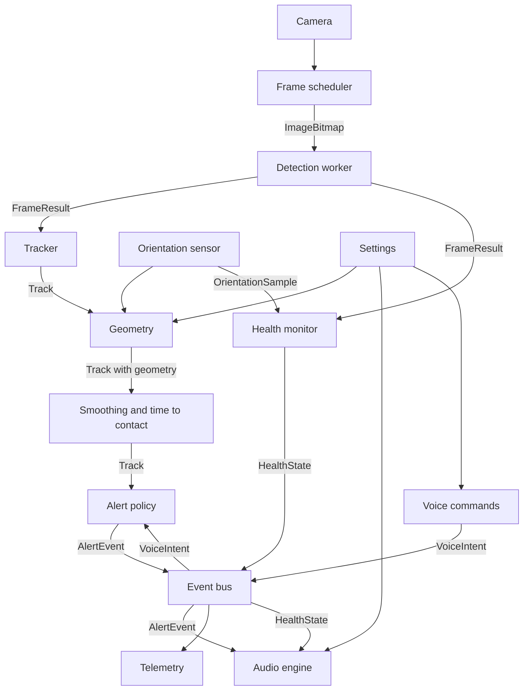

# Software Design Specification: Navigator

Version 0.1 · How we meet [SRS.md](SRS.md). Type names refer to `web/src/core/types.ts`; tunable numbers to `web/src/core/config.ts` (`CONFIG.<section>.<name>`). Numbers written here are the starting defaults from config.

## 1. Architecture overview

Everything runs in the browser. Heavy work (preprocessing, inference, postprocessing) runs in one Web Worker. Everything else is light and runs on the main thread. Modules talk through typed function calls along the main data path, and through the event bus for alerts, health, voice, settings, and telemetry. `app/pipeline.ts` wires them together.



## 2. Modules

Paths are under `web/src/`. Tests sit next to the source as `*.test.ts`. Pure logic is kept in pure functions; adapters (camera, audio, sensors, DOM) stay thin.

### 2.1 Core
- **Path:** `core/types.ts`, `core/config.ts`
- **Responsibility:** shared contracts and every tunable number.
- **Satisfies:** all (indirectly).

### 2.2 Camera
- **Path:** `camera/camera.ts`
- **Responsibility:** opens the rear camera in landscape (`CONFIG.camera`), requests a screen wake lock, reports stream loss.
- **In → out:** user gesture → a playing video element; errors → `HealthIssue` `no-camera`.
- **Satisfies:** FR-1, FR-18, SR-8.

### 2.3 Frame scheduler
- **Path:** `camera/scheduler.ts`
- **Responsibility:** latest-frame-wins capture. When the worker is idle and `1000 / maxFps` ms have passed, grabs one `ImageBitmap` stamped with `captureTimeMs` and transfers it. Never queues.
- **In → out:** video element, worker idle flag → `{frameId, captureTimeMs, bitmap}` to the worker.
- **Satisfies:** FR-1, NFR-1, NFR-12.

### 2.4 Detection worker and engine
- **Path:** `detection/worker.ts` (worker side), `detection/engine.ts` (main-thread client), `detection/preprocess.ts`, `detection/postprocess.ts`, `detection/classes.ts` (generated, exports `ClassInfo[]`)
- **Responsibility:** load the ONNX model with onnxruntime-web (WebGPU, then WebAssembly), letterbox the frame to `inputSize`, run inference, decode, apply per-class thresholds, map boxes back to normalized source-frame coordinates. Also computes `meanLuma`. Restarts the worker once on a crash.
- **In → out:** `{frameId, captureTimeMs, bitmap}` → `FrameResult`.
- **Satisfies:** FR-2, NFR-1, NFR-2, NFR-5, NFR-6, NFR-12, NFR-13.

### 2.5 Orientation sensor
- **Path:** `sensors/orientation.ts`
- **Responsibility:** requests motion permission (inside the Start tap), listens to device orientation, maps to the landscape camera axis for both landscape orientations, and exposes the latest reading.
- **In → out:** `DeviceOrientationEvent` → `OrientationSample`.
- **Satisfies:** FR-3, FR-18.

### 2.6 Geometry
- **Path:** `geometry/clock.ts`, `geometry/distance.ts`, `geometry/elevation.ts`, `geometry/path.ts`
- **Responsibility:** pure functions that turn a box, an `OrientationSample`, and `Settings` into `Clock`, distance and `DistanceSource`, `Elevation`, and `inPath`. See section 5.
- **In → out:** `Track` (box, class) + `OrientationSample | null` + `Settings` + `ClassInfo` → the same `Track` with `clock`, `distanceM`, `distanceSource`, `distanceGroundM`, `distanceBoxM`, `elevation`, `inPath` filled in.
- **Satisfies:** FR-6, FR-7, FR-8, FR-9, NFR-7.

### 2.7 Tracker, smoothing, time-to-contact
- **Path:** `tracking/tracker.ts` (matching and confirmation), `tracking/smoothing.ts`, `tracking/timeToContact.ts`
- **Responsibility:** match `Detection`s to tracks, confirm tracks, smooth boxes and distance, estimate `closingSpeedMps`, `timeToContactS`, and `approaching`. See section 6.
- **In → out:** `FrameResult` → `Track[]` (matching); geometry-annotated `Track[]` → `Track[]` with smoothed distance and motion.
- **Satisfies:** FR-4, FR-5, NFR-6.

### 2.8 Alert policy and phrases
- **Path:** `alerts/policy.ts` (decisions), `alerts/phrases.ts` (all spoken text)
- **Responsibility:** choose which tracks become `AlertEvent`s, with priority, cooldowns, and the queue rules in section 7; build phrases in the CLAUDE.md format; hold the summary, help, and health texts. `phrases.ts` is the only place spoken wording lives, so SR-2 can be tested in one file.
- **In → out:** `Track[]`, `HealthState`, `VoiceIntent`, `Settings` → `AlertEvent`.
- **Satisfies:** FR-9, FR-10, FR-11, SR-2, SR-3, SR-4, SR-7, NFR-6.

### 2.9 Event bus
- **Path:** `alerts/bus.ts`
- **Responsibility:** a minimal typed publish/subscribe keyed by `EventMap` (`frame`, `tracks`, `alert`, `alertOutcome`, `health`, `voice`, `settings`, `telemetry`). No other module imports another track's internals.
- **In → out:** `EventMap[K]` in, same payload out to subscribers.
- **Satisfies:** SR-8 (errors travel on it), integration of all tracks.

### 2.10 Audio engine
- **Path:** `audio/unlock.ts`, `audio/tones.ts`, `audio/speech.ts`, `audio/heartbeat.ts`
- **Responsibility:** unlock the `AudioContext` and speech on Start; play the panned lead-in tone; speak phrases with `speechSynthesis` at the user's rate; one utterance at a time with urgent preemption; run the heartbeat only while `HealthState.status` is `healthy` and fresh; run the paused reminder. Before speaking, drops any alert past `staleLimitMs` or whose track is gone.
- **In → out:** `AlertEvent`, `HealthState`, `Settings` → sound; emits `alertOutcome` with `AlertOutcome`.
- **Satisfies:** FR-12, FR-13, FR-17, FR-18, SR-1, SR-3, SR-4, SR-9, NFR-3, NFR-4.

### 2.11 Voice commands
- **Path:** `voice/recognizer.ts` (adapter around the browser recognizer), `voice/commands.ts` (pure text → `VoiceIntent`)
- **Responsibility:** on tap, listen up to `listenTimeoutMs`, map text to a `VoiceIntent`; on failure or silence, emit `whats-around` (tap fallback). Long press toggles `pause`/`resume`.
- **In → out:** gesture, microphone → `VoiceIntent`.
- **Satisfies:** FR-15, FR-16, FR-18.

### 2.12 Health monitor
- **Path:** `health/monitor.ts`
- **Responsibility:** pure state machine over frame arrivals, fps window, `meanLuma`, pitch, camera, worker, and audio status; produces `HealthState` and the transitions that trigger warnings (immediately on entry, repeated every `warningRepeatMs`, cleared after `recoverAfterMs`).
- **In → out:** `FrameResult`, `OrientationSample`, error signals, clock ticks → `HealthState`.
- **Satisfies:** FR-14, SR-1, SR-5, SR-6, SR-8, NFR-1.

### 2.13 Telemetry
- **Path:** `telemetry/logger.ts`, `telemetry/export.ts`
- **Responsibility:** in Test mode, subscribe to the bus and buffer `TelemetryEvent`s (capped); export as JSON Lines on a user tap. `scripts/replay.ts` reads the same files.
- **In → out:** bus events → `TelemetryEvent`; export → `.jsonl` file.
- **Satisfies:** FR-19, NFR-10 (memory cap); provides the measurements for NFR-1 to NFR-4.

### 2.14 Settings and calibration
- **Path:** `app/settings.ts` (store, persisted in `localStorage`, validated on load), `app/calibration.ts` (pure field-of-view math), `app/screens/Settings.tsx`
- **Responsibility:** hold `Settings` with defaults from config; publish changes on the bus; compute `horizontalFovDeg` from a measured width and distance (`2·atan(width / 2 / distance)`).
- **In → out:** user input → `Settings`.
- **Satisfies:** FR-17, FR-6, FR-7.

### 2.15 Pipeline orchestrator and screens
- **Path:** `app/pipeline.ts`, `app/screens/`, `app/App.tsx`
- **Responsibility:** per-frame wiring (section 3), Start sequence, pause/resume, aria-live status line, large Talk area, first-run text stating the cane is still needed.
- **Satisfies:** FR-16, FR-18, NFR-9, NFR-10, NFR-11, NFR-12, SR-7, SR-8.

### 2.16 Offline cache
- **Path:** `web/public/sw.js` (hand-written service worker), registered from `app/pipeline.ts`
- **Responsibility:** cache the app shell, onnxruntime-web files, and the model on first load; serve them offline. Cached responses keep the original cross-origin isolation headers.
- **Satisfies:** NFR-8.

### 2.17 Describe (Stretch, S6)
- **Path:** `app/describe.ts`, `web/api/describe.ts` (one Vercel function; the Claude API key lives only in a Vercel environment variable)
- **Responsibility:** on `describe`, downscale one frame to `CONFIG.describe.maxImageSidePx`, send it, speak the reply as an `info` alert that urgent alerts can preempt. Created in S6; not part of the first build.
- **Satisfies:** FR-20, NFR-9 (the single exception).

## 3. Per-frame data flow

1. **Capture.** The scheduler sees an idle worker and a due frame; stamps `captureTimeMs = performance.now()`; transfers the `ImageBitmap` to the worker. If the worker is busy it skips the frame.
2. **Worker.** Letterbox to `inputSize`, build the tensor, compute `meanLuma`, run inference, decode, threshold per class, unletterbox. Posts a `FrameResult`.
3. **Health.** The monitor records the arrival (fps window, stall timer, light).
4. **Track.** The tracker matches detections to tracks and updates confirmation.
5. **Geometry.** For each track, geometry adds clock, distance, elevation, and `inPath` using the latest `OrientationSample` and `Settings`.
6. **Motion.** Smoothing and time-to-contact set `closingSpeedMps`, `timeToContactS`, `approaching`.
7. **Policy.** The policy turns eligible tracks into `AlertEvent`s and publishes them.
8. **Audio.** The audio engine runs the stale check and track check, plays the tone, then speaks.
9. **Telemetry.** In Test mode, a `frame` entry (with detections and orientation) and `alert` outcomes are logged.

All timestamps use `performance.now()` on the main thread, so every latency is measured from `captureTimeMs`.

## 4. Latency budget

Budget for the **urgent path**, from the capture of the confirming frame, using p95 values. Sums of p95s overstate the real p95, so the margin is conservative.

| Stage | Budget (ms) | Cumulative (ms) | Notes |
|---|---|---|---|
| Capture (frame grab to bitmap) | 30 | 30 | `createImageBitmap` from the video |
| Transfer to worker | 5 | 35 | transferable, no copy |
| Preprocess | 15 | 50 | letterbox and tensor build |
| Inference | 120 | 170 | NFR-2 |
| Postprocess | 10 | 180 | NMS-free model output: threshold and scale |
| Tracking and geometry | 10 | 190 | main thread, pure functions |
| Alert policy | 5 | 195 | |
| Audio start (urgent tone) | 25 | **220** | NFR-3 target 300; margin 80 |
| Tone duration | 120 | 340 | `toneDurationMs` |
| Gap and speech start | 150 | **490** | 80 ms `toneToSpeechGapMs` plus 70 ms for speech to begin; NFR-4 target 600, margin 110 |

Notes:
- A track becomes confirmed on its second matched frame, so confirmation adds up to one frame interval (about 125 ms at 8 fps) before this clock starts. NFR-3 and NFR-4 count from the frame that confirms.
- At 8 fps a new frame arrives every 125 ms, so mean inference must stay near 60 to 80 ms for NFR-1 to hold while p95 stays at 120 ms.
- Speech start on iOS is the least predictable stage; the 70 ms allowed for it is an assumption to measure in U1. If it runs longer, the tone-to-speech gap or the tone length must shrink to hold NFR-4.

## 5. Geometry

Notation: frame size `W×H`; `u` is the box center x and `y_t`, `y_b` the top and bottom y, all normalized 0..1 from the top-left. `hFov` is the horizontal field of view, `h` the eye height, `pitch` the camera axis angle above the horizon (positive up), `roll` the rotation about the camera axis.

```
Th = tan(hFov / 2)                    tan of half the horizontal field
Tv = Th * H / W                       tan of half the vertical field
```

Before use, rotate each point `(u, y)` about `(0.5, 0.5)` by `-roll` (aspect-corrected) so the horizon is level.

**Clock position.** Horizontal angle `theta = atan((2u - 1) * Th)`, negative to the left.

| Angle | Position |
|---|---|
| `theta` < -25° | far left |
| -25° ≤ `theta` < -10° | 11 o'clock |
| -10° ≤ `theta` ≤ 10° | 12 o'clock |
| 10° < `theta` ≤ 25° | 1 o'clock |
| `theta` > 25° | far right |

The cutoffs are `clockCenterDeg` and `clockEdgeDeg`. At a 65° field the visible half-angle is 32.5°, so "far" covers the outer 7.5°.

**Depression angle.** For a normalized y, the ray points below the horizon by `delta(y) = atan((2y - 1) * Tv) - pitch` (degrees).

**Ground-plane distance** (primary). If `delta(y_b) >= minDepressionDeg` (3°), the bottom edge meets the floor, and the horizontal distance is `D = h / tan(delta(y_b))`. Used for classes with `groundContact`. Needs the orientation sensor.

**Box-size distance** (fallback). With the class's `typicalHeightM`, the frame height spans `2 * Tv * D` at distance `D`, so `D = typicalHeightM / (2 * Tv * (y_b - y_t))`. Used when the ground plane does not apply (no sensor, bottom edge above the horizon, class without ground contact). Requires the box top and bottom not to be cut off by the frame. Typical heights (m, approximate; full table in `ml/class_map.json`): person 1.7, bicycle 1.0, motorcycle 1.2, car 1.5, bus 3.0, truck 3.0, bench 0.9, chair 0.9, couch 0.85, dining table 0.75, backpack 0.45, suitcase 0.6, potted plant 0.5, fire hydrant 0.7.

**Choosing.** Prefer ground-plane, else box-size. If the box bottom is cut off (`y_b > truncatedBottomY`), the object is nearer than the closest visible floor, so report that closest visible distance, `D = h / tan(delta_max)`, with source `min-visible` (an upper bound). Both raw candidates are kept in the `Track` for tuning. Discard distances outside `minValidDistanceM`..`maxValidDistanceM`. Distances are smoothed, then spoken rounded to the nearest `roundToM` (0.5), never below 0.5.

**Lateral position and width.** `X = D * (2u - 1) * Th` (right is positive); object width `w = (box width) * 2 * Th * D`.

**Floor and head-height rules.** With `D` known, the height of an edge above the floor is `z(y) = h - D * tan(delta(y))`.
- `floor` if `z(y_t) <= floorTopMaxM` (0.6 m): a low object such as a bag on the ground.
- `head` if `z(y_b)` lies between `headBottomMinFraction * h` and `headBottomMaxFraction * h` (0.6 to 1.1 of eye height): something hanging or protruding at face level. Objects whose bottom edge is above that are over the user's head and ignored for this label.
- `body` otherwise, spoken without a suffix.

**Walking-path corridor.** An object is `inPath` if `0 < D <= corridorDepthM` (4 m) and its lateral interval `[X - w/2, X + w/2]` overlaps `[-corridorHalfWidthM, +corridorHalfWidthM]` (±0.5 m). Approaching objects use the wider `approachHalfWidthM` (±1 m).

## 6. Tracking

- **Matching.** Greedy by descending IoU between each detection and each existing track of the same class; accept when IoU ≥ `matchIou` (0.3). Unmatched detections start `tentative` tracks with a new, never-reused `id`.
- **Confirmation.** A track becomes `confirmed` when it matched in `confirmationHits` (2) of the last `confirmationWindow` (3) frames. Only confirmed tracks can raise alerts. A tentative track is deleted after `tentativeMaxMisses` (2) consecutive misses; a confirmed track after `lostAfterMs` (800 ms) without a match.
- **Smoothing.** Exponential moving average on the box (`boxSmoothing` 0.5) and on distance (`distanceSmoothing` 0.4); confidence is smoothed the same way as the box.
- **Closing speed.** Finite difference of smoothed distance over the last `closingSpeedWindowMs` (500 ms), then smoothed (`closingSpeedSmoothing` 0.3). Positive means closer. The user's own walking counts: a static obstacle ahead has a positive closing speed.
- **Time-to-contact.** `timeToContactS = distanceM / closingSpeedMps` when `closingSpeedMps >= approachMinSpeedMps` (0.5), else null.
- **Approaching.** `closingSpeedMps >= approachMinSpeedMps`, the object overlaps the widened corridor, and `timeToContactS <= approachMaxTtcS` (4 s).

## 7. Alert policy

**Eligibility.** A confirmed track with `alertable` class that is `inPath` or `approaching`, with `distanceM` within `corridorDepthM`.

**Priorities.**
- `urgent`: eligible track that is `inPath` with `distanceM <= urgentDistanceM` (1.5 m) or `timeToContactS <= urgentTtcS` (2 s). Health warnings are also `urgent`.
- `normal`: other eligible tracks.
- `info`: summaries ("what's around me"), help, status confirmations, descriptions.

**Speaking rules.**
- One alert at a time. An `urgent` alert cancels the current speech, plays its tone, and speaks. `normal` and `info` never interrupt.
- Waiting alerts are kept in a queue of at most `maxQueuedAlerts` (2), ordered by priority, then nearest distance. A newer alert for the same track replaces its queued one.
- At least `minGapMs` (800) between spoken alerts, except urgent.

**Cooldowns and re-announcement** (per track).
- First time a track is eligible: announce.
- Escalation to `urgent`: announce immediately, once per escalation; repeat no sooner than `urgentCooldownMs` (2 s).
- Entering a closer distance band (`distanceBandsM` 1.5, 3, 4): announce again after `closerBandCooldownMs` (1.5 s).
- Otherwise unchanged and still eligible: repeat only after `repeatCooldownMs` (10 s).
- A track that was deleted and reappears is a new track and is announced again.

**Stale-drop.** Before speech starts, the audio engine drops an alert if `now - frameTimeMs > staleLimitMs` (1000 ms) or if `trackId` no longer exists. Each drop is reported as `dropped-stale` or `dropped-track-gone`.

**Phrase format.** `<object>, <clock> o'clock, about <meters> meters[, on the floor | , at head height]`.
- Object: `ClassInfo.spokenName`. Clock: "11 o'clock", "12 o'clock", "1 o'clock"; for far positions, "far left" or "far right" replaces "<clock> o'clock".
- Meters: rounded to the nearest 0.5, numerals ("about 1.5 meters"); "1 meter" is singular.
- Suffix only for `floor` and `head`.
- Example: "Backpack, 1 o'clock, about 2 meters, on the floor."

**Other texts** (all in `phrases.ts`, none may contain "clear", "safe", "free", "no obstacles", or similar):
- Summary with items: up to `summaryMaxItems` (3) phrases, nearest first.
- Summary with none: "I don't detect anything right now. I can miss things, so keep using your cane."
- Health warnings, pause and resume confirmations, help, and the paused reminder.

## 8. Threading and scheduling
- **Main thread:** UI, camera, scheduler, orchestrator, tracker, geometry, policy, audio scheduling, speech, voice.
- **Detection worker:** onnxruntime-web session, preprocessing (OffscreenCanvas), inference, postprocessing. Nothing else.
- **Latest frame wins:** the scheduler holds at most one frame in flight. A busy worker means the frame is skipped, never queued. If a result is overdue by `stalledAfterMs`, the engine restarts the worker once and the health monitor reports it.
- **Backends:** try WebGPU; if creation or the first run fails, use WebAssembly. WebAssembly uses multiple threads only when `crossOriginIsolated` is true (COOP/COEP headers from Vite and Vercel); otherwise one thread, which the benchmark and health monitor will show as a low frame rate.
- **Audio path:** tones are scheduled on the `AudioContext` clock, not by timers on the main thread. No inference runs there.

## 9. Failure modes and user response

Every failure is spoken (unless spoken feedback is off), written to the aria-live region, and offers a recovery.

| Failure | Detected by | User-facing response | Recovery |
|---|---|---|---|
| Camera permission denied | camera adapter | "Camera access is needed. Allow it in Safari settings, then press Start." | Start button stays available |
| Camera stream lost (call, lock screen, tab hidden) | stream end event | "Detection stopped." Warning repeats | Restart camera on return; press Start if refused |
| Model fails to load | engine | "Could not load the detector. Check your connection and try again." | Retry button; works offline once cached |
| WebGPU unavailable | engine | Silent switch to WebAssembly; warning only if frame rate drops | Automatic |
| Worker crash or stall | engine, health | "Detection stalled." | One automatic restart, then retry button |
| Low frame rate | health | "Detection is slow." | Repeats until it recovers |
| Low light | health | "It is too dark for reliable detection." | Repeats until light improves |
| Phone lowered or raised | health | "Raise the phone to eye level." | Clears when pitch is back in range |
| Orientation sensor denied or missing | sensor | "Distance will be less accurate." (once) | Box-size distance used; re-request on Start |
| Speech output unavailable | audio | Tones keep playing; text shown large on screen | Retry on next tap |
| Audio blocked or route lost (AirPods disconnect, interruption) | audio, health | On-screen warning "Sound is off. Tap to restore." | Tap resumes the `AudioContext` |
| Speech recognition unavailable, denied, or silent | recognizer | Tap runs "what's around me" | Automatic fallback |
| Frame or alert too old | audio | Alert dropped; logged | Automatic |
| Describe request fails (stretch) | describe | "Could not describe the scene." | Try again |
| Paused | pipeline | "Paused." then a reminder every 15 s | Long press or "resume" |

## 10. Model plan

- **Base model:** YOLO26n (COCO, 80 classes). The default export is end-to-end (NMS-free), so postprocess is mostly threshold and scale; if the export turns out to need NMS, postprocess adds it. `ml/export_onnx.py` exports at the chosen size, simplifies with onnxslim, and writes `web/public/models/yolo26n-<size>.onnx` (under 15 MB).
- **Input size:** 320 or 416, decided at **Gate A** on the demo iPhone: choose 416 only if p95 inference stays at or below 120 ms and the frame rate stays at or above 8 fps; otherwise 320. Until then `CONFIG.detection.inputSize` is 320.
- **Class map:** `ml/class_map.json` is the hand-maintained source of truth (per class id: spoken name, typical height, ground contact, alertable). `ml/gen_classes.py` generates `detection/classes.ts` as `ClassInfo[]`. Initial alertable COCO classes: person, bicycle, car, motorcycle, bus, truck, bench, chair, couch, dining table, potted plant, backpack, suitcase, handbag, fire hydrant, parking meter, dog.
- **Retrained hazard model (M2, M3):** the base classes plus stairs, curb, pole, and door. COCO ids 0 to 79 keep their numbers and the new classes take 80 to 83, so the class map stays compatible. It replaces the base model only if it wins on our own field-test labels: better recall on the four new classes, no loss of more than 2 points of in-path recall on the COCO obstacle classes, no more false alerts per minute, and inference still within NFR-2 on the iPhone.
- **Stairs and curb** have no usable typical height, so their distance comes from the ground plane only (or `min-visible`).

## 11. Traceability matrix

Verification methods are the same as in the SRS.

| Requirement | Module | Verification |
|---|---|---|
| FR-1 | Camera, Frame scheduler | Field test |
| FR-2 | Detection worker and engine | Unit test, Field test |
| FR-3 | Orientation sensor | Unit test, Field test |
| FR-4 | Tracker | Unit test, Replay |
| FR-5 | Tracker (time-to-contact) | Unit test, Replay |
| FR-6 | Geometry (clock), Settings | Unit test, Replay |
| FR-7 | Geometry (distance), Settings | Unit test, Replay, Field test |
| FR-8 | Geometry (elevation) | Unit test, Replay |
| FR-9 | Geometry (path), Alert policy | Unit test, Replay |
| FR-10 | Alert policy | Unit test, Replay |
| FR-11 | Alert policy (phrases) | Unit test |
| FR-12 | Audio engine (tones) | Field test, Inspection |
| FR-13 | Audio engine (heartbeat) | Field test, Unit test |
| FR-14 | Health monitor | Unit test, Field test |
| FR-15 | Voice commands | Unit test, Field test |
| FR-16 | Voice commands, Pipeline | Field test |
| FR-17 | Settings and calibration | Unit test, Field test, Inspection |
| FR-18 | Pipeline, Audio engine, Camera, Orientation, Voice | Field test |
| FR-19 | Telemetry | Unit test, Replay, Inspection |
| FR-20 (Stretch) | Describe | Field test, Inspection |
| NFR-1 | Frame scheduler, Detection worker | Field test |
| NFR-2 | Detection worker | Field test |
| NFR-3 | Audio engine, Alert policy | Field test, Replay |
| NFR-4 | Audio engine | Field test |
| NFR-5 | Detection worker, Geometry, Alert policy | Field test, Replay |
| NFR-6 | Tracker, Alert policy | Field test, Replay |
| NFR-7 | Geometry (distance) | Field test |
| NFR-8 | Offline cache | Field test |
| NFR-9 | Pipeline, Describe | Inspection |
| NFR-10 | Pipeline, Telemetry | Field test |
| NFR-11 | Pipeline (screens) | Field test, Inspection |
| NFR-12 | Detection worker, Frame scheduler | Inspection, Field test |
| NFR-13 | Detection worker | Inspection |
| SR-1 | Audio engine (heartbeat), Health monitor | Unit test, Field test |
| SR-2 | Alert policy (phrases) | Unit test, Inspection |
| SR-3 | Audio engine, Alert policy | Unit test, Replay |
| SR-4 | Audio engine, Alert policy | Unit test, Field test |
| SR-5 | Health monitor | Unit test, Field test |
| SR-6 | Health monitor | Unit test, Field test |
| SR-7 | Pipeline (screens), Alert policy (help text) | Inspection |
| SR-8 | Health monitor, Event bus, Pipeline | Unit test, Inspection |
| SR-9 | Audio engine (paused reminder) | Unit test, Field test |

## 12. Uncertain design points
- The default horizontal field of view (65°) is an estimate; calibration on the demo phone replaces it.
- The WebGPU path on the demo iPhone's iOS version is unverified; the WebAssembly fallback is the planned floor.
- The exact YOLO26n ONNX output layout is verified in M1 and A1; postprocess is written against the real file.
- Speech recognition with AirPods in transparency mode may change the audio route; the tap fallback covers a failure.
- Speech-start latency on iOS (70 ms in the budget) is optimistic and must be measured.
- Letting a high-confidence in-path object skip the 2-of-3 confirmation was considered for speed and rejected for now, because it risks the false-alert target (NFR-6).
