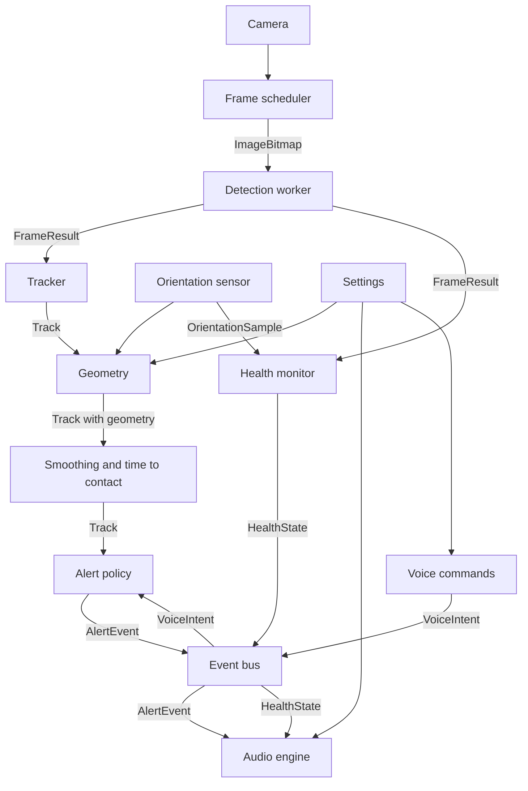
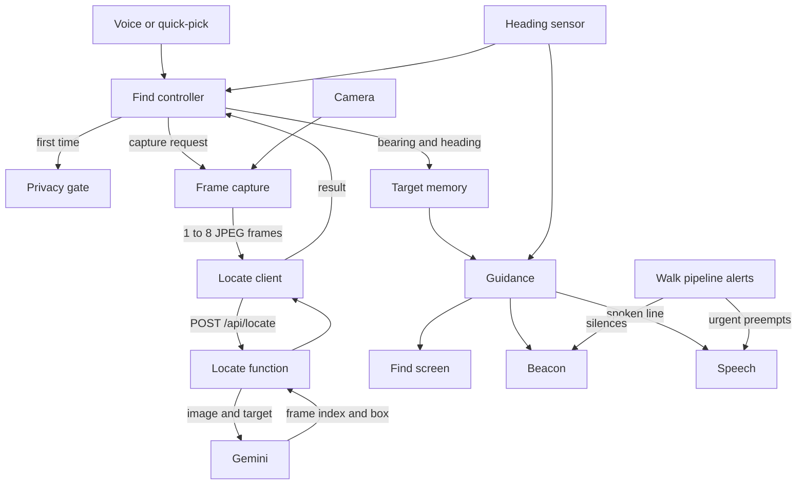

# Software Design Specification: Kenshi

Version 0.2 (Find mode pivot, step R0) · How we meet [SRS.md](SRS.md). Type names refer to `web/src/core/types.ts`; tunable numbers to `web/src/core/config.ts` (`CONFIG.<section>.<name>`). Numbers written here are the starting defaults from config.

## 1. Architecture overview

Walk mode runs entirely in the browser; Find mode adds one network call to a Vercel function that asks Gemini (section 13). Heavy work (preprocessing, inference, postprocessing) runs in one Web Worker. Everything else is light and runs on the main thread. Modules talk through typed function calls along the main data path, and through the event bus for alerts, health, voice, settings, and telemetry. `app/session.ts` owns the live run (start, pause, resume, page hide) and `app/pipeline.ts` wires each frame through the tracker and the alert policy, publishes the results on the event bus, and connects the audio link.



## 2. Modules

Paths are under `web/src/`. Tests sit next to the source as `*.test.ts`. Pure logic is kept in pure functions; adapters (camera, audio, sensors, DOM) stay thin.

### 2.1 Core
- **Path:** `core/types.ts`, `core/config.ts`
- **Responsibility:** shared contracts and every tunable number.
- **Satisfies:** all (indirectly).

### 2.2 Camera
- **Path:** `camera/camera.ts`, `camera/wakeLock.ts`
- **Responsibility:** opens the rear camera at about 1280x720 (`CONFIG.camera`) with no audio, then switches to the plain wide "Back Camera" lens when the device lists one (virtual multi-lens devices can change the field of view on their own); plays it in a muted, inline video element; reports frame-size changes (rotation) and stream loss. `wakeLock.ts` holds the screen awake while running and is re-requested on resume. Failures are typed (`permission-denied`, `no-camera`, `camera-busy`, `insecure-page`, `unknown`), each with one spoken sentence.
- **In → out:** user gesture → a playing video element and `CameraInfo`; errors → `CameraError`.
- **Satisfies:** FR-1, FR-18, SR-8.

### 2.3 Frame scheduler
- **Path:** `camera/scheduler.ts`
- **Responsibility:** latest-frame-wins capture. Driven by `requestVideoFrameCallback` (`requestAnimationFrame` where missing). When the worker is idle and 90% of `1000 / maxFps` ms have passed (`frameGapTolerance`, so camera jitter does not cost a whole frame), grabs one `ImageBitmap` stamped with `captureTimeMs` and transfers it; it also captures again as soon as a detection finishes, because waiting for the next video frame would drop a 30 fps camera to 10 fps when detection takes about 70 ms. If a bitmap cannot be made from the video element it draws to a canvas instead. Never queues.
- **In → out:** video element, worker idle flag → `{frameId, captureTimeMs, bitmap}` to the worker.
- **Satisfies:** FR-1, NFR-1, NFR-12.

### 2.4 Detection worker and engine
- **Path:** `detection/worker.ts` (worker side), `detection/engine.ts` (main-thread client), `detection/protocol.ts` (message types), `detection/preprocess.ts`, `detection/postprocess.ts`, `detection/classes.ts` (generated, exports `ClassInfo[]`). The onnxruntime-web WebAssembly files are copied to `public/ort/` by `web/scripts/copy-ort.mjs` before dev and build and served from our own origin.
- **Responsibility:** load the ONNX model with onnxruntime-web (WebGPU, then WebAssembly), letterbox the frame to `inputSize`, run inference, decode, apply per-class thresholds and class-aware NMS, map boxes back to normalized source-frame coordinates. Also computes `meanLuma`. Keeps only the newest waiting frame. The engine rejects loading with a typed `DetectionLoadError`; restarting the worker after a crash is the orchestrator's job (A2).
- **In → out:** `{frameId, captureTimeMs, bitmap}` → `FrameResult`.
- **Satisfies:** FR-2, NFR-1, NFR-2, NFR-5, NFR-6, NFR-12, NFR-13.

### 2.5 Orientation sensor
- **Path:** `sensors/orientation.ts` (adapter), `sensors/attitude.ts` (pure math)
- **Responsibility:** requests motion permission inside the Start tap (iOS needs a gesture), listens to `deviceorientation` only while running, turns beta and gamma into camera pitch and roll for the current screen angle (landscape either way, or upright; see the comments in `attitude.ts`), smooths them, and keeps one second of history so a frame is paired with the tilt at its capture time (`at(timeMs)`; orientation holds until it changes, so a reading counts for up to `staleAfterMs`). With permission refused, or no reading within `noDataTimeoutMs`, the status is `denied` or `unavailable`: geometry assumes the camera is level and is marked degraded, and the status line says distances are less accurate. Held sideways the angles are well behaved; held upright, roll is noisy near level.
- **In → out:** `DeviceOrientationEvent` → `OrientationSample`; status `idle | waiting | ready | denied | unavailable`.
- **Satisfies:** FR-3, FR-18.

### 2.6 Geometry
- **Path:** `geometry/geometry.ts` (all pure functions: `locate`, `locateDetection`, `cameraModel`, `roundDistance`)
- **Responsibility:** turn a box, the camera tilt, and the eye height and field of view from `Settings` into the clock position, the distance and its method, the height label, and path membership. See section 5.
- **In → out:** `BoundingBox` + `ClassInfo` + frame size + `Tilt | null` + `Settings` → `GeometryResult`: `clock`, `distanceM` (unrounded, for smoothing), `distanceRoundedM` (as spoken), `distanceSource`, `distanceGroundM`, `distanceBoxM`, `elevation`, heights, `lateralOffsetM`, `inPath`, `touchesBottom`, `degraded`. The tracker (A4) copies these onto each `Track`.
- **Satisfies:** FR-6, FR-7, FR-8, FR-9, NFR-7.

### 2.7 Tracker, smoothing, time-to-contact
- **Path:** `tracking/tracker.ts` (matching and confirmation), `tracking/smoothing.ts`, `tracking/timeToContact.ts`
- **Responsibility:** match `Detection`s to tracks, confirm tracks, smooth boxes and distance, estimate `closingSpeedMps`, `timeToContactS`, and `approaching`. See section 6.
- **In → out:** `FrameResult` → `Track[]` (matching); geometry-annotated `Track[]` → `Track[]` with smoothed distance and motion.
- **Satisfies:** FR-4, FR-5, NFR-6.

### 2.8 Alert policy and phrases
- **Path:** `alerts/policy.ts` (decisions), `alerts/phrases.ts` (the wording of object alerts and the "what's around me" answer)
- **Responsibility:** choose which tracks become `AlertEvent`s, with priority, pan, cooldowns, and the queue rules in section 7; build the object phrases in the CLAUDE.md format; answer "what's around me". Pure: the caller passes the time. `phrases.ts` holds the object and summary wording, so SR-2 can be tested in one file; health, voice, and help texts live with their own modules (`health/monitor.ts`, `voice/commands.ts`), and `alerts/wording.test.ts` checks the wording of all of them against the SR-2 word list.
- **In → out:** `Track[]` + the time of the frame and the current time → at most one `AlertEvent` per frame, plus the alerts it dropped; `notifyOutcome(alertId, AlertOutcome)` from the audio side; `summarize(Track[])` → one phrase.
- **Satisfies:** FR-9, FR-10, FR-11, SR-2, SR-3, SR-4, SR-7, NFR-6.

### 2.9 Event bus
- **Path:** `alerts/bus.ts`
- **Responsibility:** a minimal typed publish/subscribe keyed by `EventMap` (`frame`, `tracks`, `alert`, `alertOutcome`, `health`, `voice`, `settings`). A listener that throws is reported (`console.error`) and does not stop the others. No other module imports another track's internals. The pipeline publishes `frame`, `tracks`, `alert`, `alertOutcome`, `health`, and `voice`. Find mode adds its own topics in step R4.
- **In → out:** `EventMap[K]` in, same payload out to subscribers.
- **Satisfies:** SR-8 (errors travel on it), integration of all tracks.

### 2.10 Audio engine
- **Path:** `audio/unlock.ts`, `audio/tones.ts`, `audio/speech.ts`, `audio/heartbeat.ts`, `audio/engine.ts` (ties them together); `app/audioLink.ts` connects the session, health monitor, and engine; `app/screens/AudioTestPanel.tsx` fires sample alerts under `?debug`
- **Tones:** urgent is `urgentPulseCount` high pulses whose gap shrinks with distance (unknown distance pulses fastest); normal is one mid tone; info one softer low tone; the health warning is two falling tones, centered; the heartbeat is a short soft click. Pan comes from `AlertEvent.pan` (`panFromAngle` maps a horizontal angle to -1..1).
- **Speech:** at most one phrase waiting (the newest wins); urgent cancels and speaks at once; an enhanced local English voice is preferred once `voiceschanged` lists voices; a watchdog ends a phrase whose end event never comes, so the heartbeat cannot stay blocked.
- **Responsibility:** unlock the `AudioContext` and speech on Start; play the panned lead-in tone; speak phrases with `speechSynthesis` at the user's rate; one utterance at a time with urgent preemption; run the heartbeat only while `HealthState.status` is `healthy` and fresh; run the paused reminder. Before speaking, drops any alert past `staleLimitMs` or whose track is gone.
- **In → out:** `AlertEvent`, `HealthState`, `Settings` → sound; emits `alertOutcome` with `AlertOutcome`.
- **Satisfies:** FR-12, FR-13, FR-17, FR-18, SR-1, SR-3, SR-4, SR-9, NFR-3, NFR-4.

### 2.11 Voice commands
- **Path:** `voice/recognizer.ts` (adapter around the browser recognizer), `voice/commands.ts` (pure text → `VoiceIntent`)
- **Responsibility:** on tap, listen up to `listenTimeoutMs`, map text to a `VoiceIntent`; on failure or silence, emit `whats-around` (tap fallback). Long press toggles `pause`/`resume`.
- **In → out:** gesture, microphone → `VoiceIntent`.
- **Satisfies:** FR-15, FR-16, FR-18.

### 2.12 Health monitor
- **Path:** `health/monitor.ts`; `app/audioLink.ts` feeds it frames and the session's latest `OrientationSample`
- **Responsibility:** pure state machine over frame arrivals, fps window, `meanLuma`, pitch, camera, worker, and audio status; produces `HealthState` and the transitions that trigger warnings (immediately on entry, repeated every `warningRepeatMs`, cleared after `recoverAfterMs`).
- **In → out:** `FrameResult`, `OrientationSample`, error signals, clock ticks → `HealthState`.
- **Satisfies:** FR-14, SR-1, SR-5, SR-6, SR-8, NFR-1.

### 2.13 Telemetry (removed)
- **Removed in step R0** with the field-test rounds: `telemetry/` (logger, export, session metadata, replay engine, simulated walk), `app/useTelemetry.ts`, the Test mode setting and overlay, the Save test log button, `scripts/replay.ts`, `scripts/make-fixture.ts`, `ml/eval_walks.py`, `field-tests/`, and the `telemetry` topic on the event bus. FR-19 is marked removed in the SRS.

### 2.14 Settings and calibration
- **Path:** `app/settings.ts` (store persisted in `localStorage`, values clamped on load and on change, safe when storage is blocked), `app/useSettings.ts`, `app/calibration.ts` (pure field-of-view math and the written steps), `app/screens/Settings.tsx`, `app/screens/Calibrate.tsx`
- **Responsibility:** hold `Settings` with defaults from config. The Settings screen (a button on the Start screen) sets the eye height and opens the calibration. Calibrate shows the live camera with a vertical center line, the live pitch and roll, and the steps, written and read aloud: stand 1 m from a wall, hold the phone level and sideways at eye level, have a teammate mark the wall at the left and right edges of the view, measure the width, enter it. The field of view is `2·atan(width / 2 / distance)`, rejected outside `minFovDeg`..`maxFovDeg`, and is stored. It is measured for the stream the app actually uses (same camera and size), and applies to the landscape picture.
- **In → out:** user input → `Settings`. Publishing changes on the event bus waits for the bus (S3); for now the store notifies subscribers directly.
- **Satisfies:** FR-17, FR-6, FR-7.

### 2.15 Pipeline orchestrator and screens
- **Path:** `app/session.ts` (start, pause, resume, page hide, shutdown), `app/useSession.ts`, `app/messages.ts`, `app/pipeline.ts` and `app/usePipeline.ts` (tracker, alert policy, event bus, audio link), `app/screens/` (including `DebugOverlay.tsx`, shown with `?debug`, which draws the pipeline's tracks and shows its alerts as captions), `App.tsx`.
- **Responsibility:** per-frame wiring (section 3), Start sequence (wake lock, camera, and model load all start in the Start tap), pause/resume, aria-live status line, large Talk area, first-run text stating the cane is still needed. Landscape-first layout that also works upright.
- **Satisfies:** FR-16, FR-18, NFR-9, NFR-10, NFR-11, NFR-12, SR-7, SR-8.

### 2.16 Offline cache (removed)
- Never built. NFR-8 is removed: the app has no service worker, and Find needs a network. Home Screen install (FR-29, step R1) uses a manifest and icons only.

### 2.17 Describe (removed)
- The stretch "describe" command and `web/api/describe.ts` were dropped. Find mode (section 13) replaces them as the only feature that sends frames off the phone.

### 2.18 Find mode modules
- Planned in steps R1 to R7; components, data flow, state machine, and latency budget are in section 13. They reuse the camera, orientation, geometry, tracker, alert policy, event bus, tones, speech, voice, and health modules (see PROGRESS.md).

## 3. Per-frame data flow

1. **Capture.** The scheduler sees an idle worker and a due frame; stamps `captureTimeMs = performance.now()`; transfers the `ImageBitmap` to the worker. If the worker is busy it skips the frame.
2. **Worker.** Letterbox to `inputSize`, build the tensor, compute `meanLuma`, run inference, decode, threshold per class, unletterbox. Posts a `FrameResult`.
3. **Health.** The monitor records the arrival (fps window, stall timer, light).
4. **Track.** The tracker matches detections to tracks and updates confirmation.
5. **Geometry.** For each track, geometry adds clock, distance, elevation, and `inPath` using the latest `OrientationSample` and `Settings`.
6. **Motion.** Smoothing and time-to-contact set `closingSpeedMps`, `timeToContactS`, `approaching`.
7. **Policy.** The policy turns eligible tracks into `AlertEvent`s and publishes them.
8. **Audio.** The audio engine runs the stale check and track check, plays the tone, then speaks.

All timestamps use `performance.now()` on the main thread, so every latency is measured from `captureTimeMs`.

## 4. Latency budget

Budget for the **urgent path**, from the capture of the confirming frame, using p95 values. Sums of p95s overstate the real p95, so the margin is conservative.

| Stage | Budget (ms) | Cumulative (ms) | Notes |
|---|---|---|---|
| Capture (frame grab to bitmap) | 30 | 30 | `createImageBitmap` from the video |
| Transfer to worker | 5 | 35 | transferable, no copy |
| Preprocess | 15 | 50 | letterbox and tensor build |
| Inference | 120 | 170 | NFR-2 |
| Postprocess | 10 | 180 | decode, per-class threshold, NMS, scale to the frame |
| Tracking and geometry | 10 | 190 | main thread, pure functions |
| Alert policy | 5 | 195 | |
| Audio start (urgent tone) | 25 | **220** | NFR-3 target 300; margin 80 |
| Tone duration | 120 | 340 | `toneDurationMs` |
| Gap and speech start | 150 | **490** | 80 ms `toneToSpeechGapMs` plus 70 ms for speech to begin; NFR-4 target 600, margin 110 |

### 4.1 Measured on desktop (step A1)

Benchmark screen (`?bench`), production build, 10 warm-up and 50 timed inferences on `bus.jpg`, three runs per configuration; each cell is the range of the three runs, p50 / p95 in ms. Microsoft Edge 155 (Chromium) headless on a Windows 11 laptop (Intel Core Ultra 7 155H, integrated GPU), cross-origin isolated, 4 WebAssembly threads. **These are not iPhone numbers**; Gate A measures those.

| Configuration | Preprocess | Inference | Postprocess | Total (worker) |
|---|---|---|---|---|
| 320, WebGPU | 3.0 to 3.4 / 4.0 to 4.5 | 22.8 to 26.4 / 29.3 to 37.2 | 0.8 to 1.0 / 1.4 to 1.6 | 26.5 to 31.1 / 33.4 to 41.6 |
| 416, WebGPU | 4.7 to 5.0 / 6.0 to 6.5 | 27.0 to 29.5 / 33.8 to 55.1 | 1.5 to 1.6 / 1.9 to 2.9 | 33.5 to 36.0 / 40.0 to 62.6 |
| 320, WebAssembly | 2.3 to 2.8 / 3.1 to 3.9 | 32.0 to 56.6 / 35.4 to 68.4 | 0.5 to 0.9 / 1.0 to 1.3 | 34.9 to 60.6 / 38.4 to 72.4 |
| 416, WebAssembly | 3.7 to 4.2 / 5.1 to 6.0 | 47.9 to 53.1 / 62.0 to 79.1 | 1.0 to 1.3 / 2.6 to 2.9 | 52.8 to 59.1 / 68.1 to 83.7 |

- Model load takes about 1.2 to 1.7 s (WebAssembly) or 1.7 to 2.0 s (WebGPU). The thread hop adds only 0.3 to 0.5 ms (round trip minus worker total).
- On this machine every configuration is within NFR-2 (inference p95 at most 120 ms) and within the preprocess, inference, and postprocess budgets in the table above. Run-to-run spread is large (for example 320 WebAssembly p50 inference 32 to 57 ms), so decide Gate A on repeated iPhone runs, not one.
- The capture, transfer, tracking, and audio rows are not measured yet (A2 and U1).

Notes:
- A track becomes confirmed on its second matched frame, so confirmation adds up to one frame interval (about 125 ms at 8 fps) before this clock starts. NFR-3 and NFR-4 count from the frame that confirms.
- At 8 fps a new frame arrives every 125 ms, so mean inference must stay near 60 to 80 ms for NFR-1 to hold while p95 stays at 120 ms.
- Speech start on iOS is the least predictable stage; the 70 ms allowed for it is an assumption to measure in U1. If it runs longer, the tone-to-speech gap or the tone length must shrink to hold NFR-4.

## 5. Geometry

Implemented in `geometry/geometry.ts`. Notation: frame `W×H` pixels; `f` the focal length in pixels, `f = (W / 2) / tan(hFov / 2)`; `h` the eye height; `pitch` the camera axis angle above the horizon (positive up); `roll` the rotation about the camera axis (positive clockwise as seen from behind the phone).

A pixel `(px, py)` becomes a ray `(u, v) = ((px - W/2) / f, (py - H/2) / f)` (right, down). The roll is taken out by turning the ray clockwise by `roll`: `u' = u cos(roll) - v sin(roll)`, `v' = u sin(roll) + v cos(roll)`. Then, with the camera axis tilted by `pitch`:

```
forward = cos(pitch) + v' * sin(pitch)
down    = v' * cos(pitch) - sin(pitch)
tan(angle below the horizon) = down / forward
bearing = atan2(u', forward)            horizontal angle, positive to the right
```

A ray with `forward <= 0` points backward and is ignored. Edge touching: a box touches an edge when it is within `edgeTouchMargin` (0.02 of the frame) of it.

**Clock position.** `theta` is the bearing of the box center. A box touching only the left edge is **far left**, only the right edge **far right** (touching both fills the view, so the angle decides). Otherwise `|theta| <= clockCenterDeg` (15°) is **12 o'clock**, more to the right is **1**, more to the left **11**. Beyond 15° the position stays 1 or 11 up to the edge of the picture.

**Ground-plane distance** (primary). For a class with `groundContact`, when the box does not touch the bottom edge and its bottom edge points at least `minDepressionDeg` (3°) below the horizon: `D = h / tan(angle below the horizon at the bottom-center point)`. This is the distance ahead (along the forward direction), not the straight-line distance.

**Box-size distance** (fallback). `D = typicalHeightM * f / (box height in pixels)`, for classes with a typical height. It is reliable only if the box touches neither the top nor the bottom edge.

**Nearest visible floor.** `D_min = h / tan(angle below the horizon at the bottom-center of the frame)`. An object cut off by the bottom edge is no farther than this.

**Choosing.** Candidates outside `minValidDistanceM`..`maxValidDistanceM` (0.3 to 10 m) are discarded. Then:
1. No tilt reading (degraded) and a reliable box-size value: use **box-size**, because the ground plane would be a guess.
2. Else a valid ground-plane value: use **ground-plane**.
3. Else, if the box touches the bottom edge: use the nearer of the box-size value and `D_min` (source `box-size` or `min-visible`). Both tend to overestimate for a cut-off object, so this is a limit, not an estimate.
4. Else the box-size value, if any.
5. Otherwise there is no distance (`null`): the object is not in the path and gets no height label.

Both raw candidates are kept in the result for tuning. The distance is smoothed by the tracker, then spoken rounded to the nearest `roundToM` (0.5 m), never below 0.5 m (`roundDistance`).

**Heights.** With `D` known, an edge's height above the floor is `z = h - D * tan(angle below the horizon at that edge)`, for the top and bottom of the box.
- `floor` if the box does not touch the top edge and `z(top) <= floorTopMaxM` (0.5 m): a low object such as a bag on the ground.
- `head` if the box does not touch the bottom edge and `z(bottom)` lies between `headBottomMinM` (1.2 m) and `headBottomMaxM` (2.0 m): something hanging or protruding at face level. A bottom edge above 2.0 m passes over the head and gets no label.
- `body` otherwise, spoken without a suffix.

**Walking-path corridor.** Lateral offset `X = D * tan(theta)` (right is positive). An object is `inPath` if `D <= corridorDepthM` (4 m) and `|X| <= corridorHalfWidthM` (0.5 m); only the box center counts, not its width. Approaching objects use the wider `approachHalfWidthM` (1 m), applied by the tracker.

**Known limits.**
- A cut-off box (touching the bottom edge) is the weak case: an object about 1 m away can read 1.5 m or more. The policy should treat `touchesBottom` as "close".
- Box-size distance assumes the object stands upright and has the class's typical height; a short person or a tall chair is off by that ratio.
- The pitch and roll signs follow the W3C Euler convention and the unit tests, but have not been checked on the demo iPhone: tilt the phone down and the pitch readout must go negative.

## 6. Tracking

- **Matching.** Greedy by descending IoU between each detection and each existing track of the same class; accept when IoU ≥ `matchIou` (0.3). Unmatched detections start `tentative` tracks with a new, never-reused `id`.
- **Confirmation.** A track becomes `confirmed` when it matched in `confirmationHits` (2) of the last `confirmationWindow` (3) frames. Only confirmed tracks can raise alerts. A tentative track is deleted after `tentativeMaxMisses` (2) consecutive misses; a confirmed track after `lostAfterMs` (800 ms) without a match.
- **Smoothing.** Exponential moving average on the box (`boxSmoothing` 0.5) and on distance (`distanceSmoothing` 0.4); confidence is smoothed the same way as the box.
- **Fast confirmation.** A new track nearer than `nearConfirmDistanceM` (2 m) with confidence of at least `nearConfirmConfidence` (0.7) is confirmed on its first frame.
- **Small boxes.** When IoU fails, two boxes with a longer side below `smallBoxMaxSide` (0.12) still match if their centers are within `smallBoxCenterFactor` longer sides.
- **Frame rate.** Smoothing factors are per `smoothingRefMs` (67 ms) and rescaled by the actual time between frames; motion uses timestamps only.
- **Closing speed.** Least-squares slope of smoothed distance over the last `closingSpeedWindowMs` (500 ms, at least `minMotionSamples` samples spanning half the window), then smoothed (`closingSpeedSmoothing` 0.3). Positive means closer. The user's own walking counts: a static obstacle ahead has a positive closing speed.
- **Time-to-contact.** `timeToContactS = distanceM / closingSpeedMps` when `closingSpeedMps >= approachMinSpeedMps` (0.5), else null.
- **Height fallback.** Without a distance, `timeToContactS = 1 / g`, where g is the slope of ln(box height) per second, when g is at least `minHeightGrowthPerS`.
- **Approaching.** `timeToContactS <= approachMaxTtcS` (4 s), the object within the widened corridor (`approachHalfWidthM`), held for `approachHoldMs` (300 ms).

## 7. Alert policy

Implemented in `alerts/policy.ts` and `alerts/phrases.ts`, run by `app/pipeline.ts` once per frame.

**Eligibility.** A confirmed track of an announced class (`ClassInfo.alertable`) that is `inPath` with `distanceM` within `corridorDepthM`, or `approaching` with `timeToContactS <= approachMaxTtcS` (4 s).

**Priorities.**
- `urgent`: eligible and `inPath` with `distanceM <= urgentDistanceM` (1.5 m) or `timeToContactS <= urgentTtcS` (2 s). Health warnings are also `urgent`.
- `normal`: any other in-path track.
- `info`: a track that is approaching but outside the path. The audio engine uses `info` for summaries, help, and status too.

**When a track is announced.** Each track is announced once. It is announced again only when:
- it becomes urgent (escalation; again no sooner than `urgentCooldownMs` (2 s) after its last urgent alert, and a fall back below urgent makes a later return a new escalation);
- it enters the path (after `closerBandCooldownMs`, 1.5 s);
- it moves into a closer distance band (`distanceBandsM` 1.5, 3, 4), measured against the band last announced, after `closerBandCooldownMs`;
- its clock position changes, after `clockChangeCooldownMs` (3 s).

There is **no repeat on a timer**: a stationary chair is announced once however long you stand there (the heartbeat, not repetition, shows the app is working). A track that disappears and returns gets a new id and is announced again. The first draft of this section also repeated an unchanged object every 10 s; step A5 removed that, and `repeatCooldownMs` with it.

**Speaking rules.**
- One alert in flight. The policy learns when it ends from `notifyOutcome` (the audio link reports `finished`, `preempted`, or a drop through the bus), and treats it as ended `inFlightTimeoutMs` (8 s) after it was sent if nothing is reported, so a missing report cannot silence later alerts. At least `minGapMs` (800 ms) passes before the next one, except urgent.
- Urgent preempts a non-urgent alert in flight. It never cuts off another urgent alert; it waits for it.
- Waiting alerts: at most `maxQueuedAlerts` (2). More than that are held back (their track is not marked as announced, so they come up again as room appears), and a nearer or more urgent arrival pushes out the least important waiting alert. When several compete, the most urgent goes first, then the nearest. A newer alert for the same track replaces its waiting one.
- A waiting alert follows its track: it is rewritten from every new frame, so waiting behind speech never makes it stale.

**Dropping.** Every drop is recorded with a reason (`DropRecord`, also kept in `getDropLog()`): `stale` (the frame feeding the policy is older than `staleLimitMs`, 1 s; waiting alerts are dropped and nothing is announced from it), `track-gone`, `not-eligible` (its track left the path), `superseded`, or `queue-full`. The first two are also published as `alertOutcome` (`dropped-stale`, `dropped-track-gone`). The audio engine makes its own last-moment check, right before speech starts, for the same two conditions (SR-3).

**An alert that was not heard is announced again.** If the audio engine reports an alert as dropped or cut off, or if an urgent alert cuts off a normal one, the track is treated as not yet announced and comes up again from a fresh frame (unless a newer alert for it is already waiting). Without this, one dropped alert, for example one that waited behind the Start greeting, would mean the user never hears about that object.

**Tone.** The pan follows the horizontal angle: `-1` full left to `+1` full right, reaching full at `panFullAngleDeg` (30°). The pulse rate of the urgent tone is worked out by the audio engine from the track's live distance when the tone starts (`audio/tones.ts`), so it rises as the object nears; the policy does not duplicate that.

**Phrase format.** `<object>, <clock> o'clock, about <meters> meters[, on the floor | , at head height]`.
- Object: `ClassInfo.spokenName`, capitalized. Clock: "11 o'clock", "12 o'clock", "1 o'clock"; for far positions, "far left" or "far right" replaces "<clock> o'clock". The distance is left out when unknown ("Pole, far right.").
- Meters: rounded to the nearest 0.5, numerals ("about 1.5 meters"); "1 meter" is singular.
- Suffix only for `floor` and `head`.
- Example: "Backpack, 1 o'clock, about 2 meters, on the floor."

**"What's around me".** The nearest `summaryMaxItems` (5) confirmed tracks of announced classes within `summaryMaxDistanceM` (6 m), in or out of the path, each as the same short phrase, in clock order from left to right. With none: "I don't detect anything right now. I can miss things, so keep using your cane." Every sentence in `phrases.ts`, and the health, voice, status, and greeting texts, is tested against the SR-2 word list (no "clear", "safe", "free", "no obstacles").

## 8. Threading and scheduling
- **Main thread:** UI, camera, scheduler, orchestrator, tracker, geometry, policy, audio scheduling, speech, voice.
- **Detection worker:** onnxruntime-web session, preprocessing (OffscreenCanvas), inference, postprocessing. Nothing else.
- **Latest frame wins:** the scheduler holds at most one frame in flight. A busy worker means the frame is skipped, never queued. If a result is overdue by `stalledAfterMs`, the engine restarts the worker once and the health monitor reports it.
- **Backends:** try WebGPU; if creation or the first run fails, use WebAssembly. WebAssembly uses multiple threads (up to `maxWasmThreads`) only when `crossOriginIsolated` is true (COOP/COEP headers from Vite and Vercel); otherwise one thread, which the benchmark and health monitor will show as a low frame rate. Forcing WebGPU on a device without it fails with a typed `webgpu-unavailable` error; "auto" falls back to WebAssembly and reports why.
- **Audio path:** tones are scheduled on the `AudioContext` clock, not by timers on the main thread. No inference runs there.

## 9. Failure modes and user response

Every failure is spoken (unless spoken feedback is off), written to the aria-live region, and offers a recovery.

| Failure | Detected by | User-facing response | Recovery |
|---|---|---|---|
| Camera permission denied | camera adapter | "Camera access is needed. Allow it in Safari settings, then press Start." | Start button stays available |
| Camera stream lost (call, lock screen, tab hidden) | stream end event | "Detection stopped." Warning repeats | Restart camera on return; press Start if refused |
| Model fails to load | engine | "Could not load the detector. Check your connection and try again." | Retry button; works offline once cached |
| WebGPU unavailable | engine | Silent switch to WebAssembly; warning only if frame rate drops | Automatic |
| Worker crash or stall | engine, health | "Detection stalled." | One automatic restart, then retry button |
| Low frame rate | health | "Detection is slow." | Repeats until it recovers |
| Low light | health | "Too dark to detect reliably." | Repeats until light improves |
| Phone lowered or raised | health | "Raise the phone to eye level." (or "Lower …" when pointed up) | Clears when pitch is back in range |
| Health warning clears (after `recoverAfterMs` of good readings) | health | "Detection back." once | Heartbeat resumes |
| Orientation sensor denied or missing | sensor | "Distance will be less accurate." (once) | Box-size distance used; re-request on Start |
| Speech output unavailable | audio | Tones keep playing; text shown large on screen | Retry on next tap |
| Audio blocked or route lost (AirPods disconnect, interruption) | audio, health | On-screen warning "Sound is off. Tap the screen to restore it." | Tap resumes the `AudioContext` |
| Speech recognition unavailable, denied, or silent | recognizer | Tap runs "what's around me" | Automatic fallback |
| Frame or alert too old | audio | Alert dropped; logged | Automatic |
| Find has no network | locate client | "I can't reach the internet, so I can't search." | Try again; Walk mode keeps running |
| Gemini rate limit or server error | locate function | "The search service is busy. Try again in a moment." | Try again; offer a retry after a pause |
| Find request times out | locate client | "The search took too long." | Try again |
| Target not found | locate result | "I could not find it." (never "it is not here") | Offer the scan sweep, or another target |
| Heading unavailable (no motion permission) | heading sensor | "I can't tell which way you turn, so I can only search what the camera sees." | Single-frame search only |
| Privacy notice not accepted | Find controller | "Find sends pictures to Google. Say yes to allow it, or no to cancel." | Find does not start until accepted |
| Paused | pipeline | "Paused." then a reminder every 15 s | Long press or "resume" |

## 10. Model plan

- **Base model:** YOLO26n (COCO, 80 classes). `ml/export_onnx.py` exports it at 320 and 416 (opset 18, simplified by onnxslim) to `web/public/models/yolo26n-<size>.onnx` (9.8 MB each, under the 15 MB limit). The export used here is **raw**: one output of shape `[1, 4 + 80, N]` (N is 2100 at 320 and 3549 at 416) holding center x, center y, width, and height in input pixels, then one score per class (already between 0 and 1). The graph contains no NMS, so postprocess decodes it, applies per-class thresholds, and runs class-aware NMS (`nmsIou`). An end-to-end NMS-free export also exists and could trim postprocess later, but postprocess already measures under 3 ms (section 4.1).
- **Input size: 416.** Gate A chose 416 (owner decision after running the benchmark on the demo iPhone); `CONFIG.detection.inputSize` is 416 and the app loads `yolo26n-416.onnx`. The rule for this choice was to take 416 only if p95 inference stays at or below 120 ms and the frame rate stays at or above 8 fps, otherwise 320. The iPhone numbers are not recorded in this repository yet; add them to section 4.1. The 320 model stays available for the benchmark and as a fallback if NFR-1 or NFR-2 fail in the field.
- **Class map:** `ml/class_map.json` is the hand-maintained source of truth (per class id: spoken name, typical height, ground contact, alertable). `ml/gen_classes.py` generates `detection/classes.ts` as `ClassInfo[]`. Initial alertable COCO classes: person, bicycle, car, motorcycle, bus, truck, bench, chair, couch, dining table, potted plant, backpack, suitcase, handbag, fire hydrant, parking meter, dog.
- **Retrained hazard model dropped (step R0).** Steps M2 and M3 and their datasets, training notebook, and comparison tool were removed. The base model stays; the generated class table in `detection/classes.ts` has the 80 COCO classes.

## 11. Traceability matrix

Verification methods are the same as in the SRS.

| Requirement | Module | Verification |
|---|---|---|
| FR-1 | Camera, Frame scheduler | Field test |
| FR-2 | Detection worker and engine | Unit test, Field test |
| FR-3 | Orientation sensor | Unit test, Field test |
| FR-4 | Tracker | Unit test |
| FR-5 | Tracker (time-to-contact) | Unit test |
| FR-6 | Geometry (clock), Settings | Unit test |
| FR-7 | Geometry (distance), Settings | Unit test, Field test |
| FR-8 | Geometry (elevation) | Unit test |
| FR-9 | Geometry (path), Alert policy | Unit test |
| FR-10 | Alert policy | Unit test |
| FR-11 | Alert policy (phrases) | Unit test |
| FR-12 | Audio engine (tones) | Field test, Inspection |
| FR-13 | Audio engine (heartbeat) | Field test, Unit test |
| FR-14 | Health monitor | Unit test, Field test |
| FR-15 | Voice commands | Unit test, Field test |
| FR-16 | Voice commands, Pipeline | Field test |
| FR-17 | Settings and calibration | Unit test, Field test, Inspection |
| FR-18 | Pipeline, Audio engine, Camera, Orientation, Voice | Field test |
| FR-19 (removed) | none | n/a |
| FR-20 (removed) | none | n/a |
| FR-21 | Target list, Voice commands, Find controller | Unit test, Field test |
| FR-22 | Frame capture, Locate client, Locate function | Unit test, Field test, Inspection |
| FR-23 | Scan planner, Heading, Find controller | Unit test, Field test |
| FR-24 | Heading, Target memory | Unit test, Field test |
| FR-25 | Guidance, Speech | Unit test, Field test |
| FR-26 | Beacon, Audio engine | Unit test, Field test |
| FR-27 | Find screen | Inspection, Field test |
| FR-28 | Path line | Unit test, Inspection, Field test |
| FR-29 | Install files | Inspection, Field test |
| FR-30 | Privacy gate, Settings | Unit test, Field test, Inspection |
| NFR-1 | Frame scheduler, Detection worker | Field test |
| NFR-2 | Detection worker | Field test |
| NFR-3 | Audio engine, Alert policy | Field test |
| NFR-4 | Audio engine | Field test |
| NFR-5 | Detection worker, Geometry, Alert policy | Field test |
| NFR-6 | Tracker, Alert policy | Field test |
| NFR-7 | Geometry (distance) | Field test |
| NFR-8 (removed) | none | n/a |
| NFR-9 | Pipeline, Locate client, Locate function, Privacy gate | Inspection |
| NFR-10 | Pipeline | Field test |
| NFR-11 | Pipeline (screens) | Field test, Inspection |
| NFR-12 | Detection worker, Frame scheduler | Inspection, Field test |
| NFR-13 | Detection worker | Inspection |
| NFR-14 | Locate client, Locate function | Field test |
| NFR-15 | Beacon, Heading | Field test |
| NFR-16 | Install files | Field test |
| SR-1 | Audio engine (heartbeat), Health monitor | Unit test, Field test |
| SR-2 | Alert policy (phrases) | Unit test, Inspection |
| SR-3 | Audio engine, Alert policy | Unit test |
| SR-4 | Audio engine, Alert policy | Unit test, Field test |
| SR-5 | Health monitor | Unit test, Field test |
| SR-6 | Health monitor | Unit test, Field test |
| SR-7 | Pipeline (screens), Alert policy (help text) | Inspection |
| SR-8 | Health monitor, Event bus, Pipeline | Unit test, Inspection |
| SR-9 | Audio engine (paused reminder) | Unit test, Field test |
| SR-10 | Audio engine, Beacon, Find controller | Unit test, Field test |
| SR-11 | Guidance (phrases) | Unit test, Inspection |

## 12. Uncertain design points
- The default horizontal field of view (65°) is an estimate; calibration on the demo phone replaces it.
- The WebGPU path on the demo iPhone's iOS version is unverified; the WebAssembly fallback is the planned floor.
- Speech recognition with AirPods in transparency mode may change the audio route; the tap fallback covers a failure.
- Speech-start latency on iOS (70 ms in the budget) is optimistic and must be measured.
- Letting a high-confidence in-path object skip the 2-of-3 confirmation was considered for speed and rejected for now, because it risks the false-alert target (NFR-6). (A4 later added a near-object fast path at the owner's request; see PROGRESS.md.)
- Find: the Gemini model, its free-tier limits, its latency, and how well it boxes arbitrary household targets are all to be measured (section 13.4).
- Find: gyroscope yaw drifts and has no north reference, so a stored heading is only good for a short time; how short is to be measured.
- Find: a distance for an arbitrary target is only possible when its box bottom is on the floor (ground plane); otherwise guidance gives direction only.

## 13. Find mode (steps R1 to R7)

Find mode is a "Find My" for blind users. The user names a target; a Gemini model finds it in camera frames; the app turns its box into a direction, remembers that direction as a device heading, and guides the user with an arrow, spoken directions, and an audio beacon while Walk mode keeps watching for obstacles. Requirements: FR-21 to FR-30, NFR-14 to NFR-16, SR-10, SR-11. Numbers marked **to be measured** have no justification yet and must not be treated as targets.

### 13.1 Components

| Component | Path (step) | Responsibility |
|---|---|---|
| Install files | `public/manifest.webmanifest`, `public/icons/` (drawn by `ml/make_icons.py`), `index.html` meta (R1, done) | Home Screen install, standalone display, black status bar, no `orientation` field (portrait and both landscapes work), no service worker (FR-29) |
| Locate function | `web/api/locate.ts` (R2, done) | One Vercel function (`POST`, Web-standard handler, `maxDuration` 30 s in `vercel.json`). Validates the body (1 to 8 base64 JPEG frames, size caps, a 60-character target with control characters, quotes, and backslashes removed), refuses requests from another origin, calls Gemini `generateContent` with a JSON schema (found, frame_index, box_2d as [ymin, xmin, ymax, xmax] on 0 to 1000, label, confidence) at temperature 0, and returns a box as fractions from the top-left or `{found:false}`. An answer below `CONFIG.find.minConfidence` counts as not found. Maps Gemini failures to `rate-limited`, `not-configured`, `unavailable`, `bad-reply`. Stores nothing and logs only the error kind. Environment: `GEMINI_API_KEY` (required) and `GEMINI_MODEL` (optional; the default is `gemini-2.5-flash`, whose free-tier availability is to be confirmed). Unverified against live Gemini and on Vercel until a key is set. (FR-22) |
| Locate client | `find/locateClient.ts`, `find/locateTypes.ts`, `find/messages.ts` (R2, done) | `frameToJpegBase64` downscales a frame (longest side `CONFIG.find.maxImageSidePx`) and encodes it as base64 JPEG; `locateTarget` posts to `/api/locate` with a timeout and returns a typed result or throws a `LocateError` with a kind; `messages.ts` holds the spoken sentence for each failure (SR-2 tested). `locateTypes.ts` is the shared request, result, and error contract. (FR-22, NFR-14) |
| Frame capture | `find/capture.ts` (R4) | Grabs frames from the camera (reusing the scheduler's bitmap grabber) at the moments the controller asks for and hands them to `frameToJpegBase64`. |
| Heading | `sensors/heading.ts`, `sensors/attitude.ts` (R3) | Gyroscope yaw from device orientation, unwrapped and relative to the Find start. Pure math plus a thin adapter. (FR-24) |
| Target memory | `find/targetMemory.ts` (R3) | Pure. Stores the target name, the heading at which it was seen (bounding-box bearing added to the capture-time heading), a distance if known, and the time seen. Expires; cleared on cancel. (FR-24) |
| Scan planner | `find/scan.ts` (R4) | Pure. From the heading stream decides when to capture (about every 45 degrees, at most 8) and when the sweep is complete, and which cue to speak ("keep turning"). (FR-23) |
| Target list | `find/targets.ts` (R4) | Quick-pick list and spoken-target cleanup ("find my keys" becomes "keys"). Pure. (FR-21) |
| Find controller | `find/controller.ts` (R4) | The state machine in 13.3. Owns the privacy gate, requests, retries, cancel, and the events other modules listen to. (FR-21, FR-23, FR-30) |
| Guidance | `find/guidance.ts` (R5) | Pure. From the stored heading, the current heading, and the distance: degrees to turn, aligned or not, and the spoken line with cooldowns. All wording is tested against the SR-2 word list. (FR-25, SR-11) |
| Beacon | `audio/beacon.ts` (R5) | Pulses scheduled on the `AudioContext` clock. Rate comes from distance, pan from the relative bearing; silenced while an urgent alert plays. (FR-26, SR-10) |
| Find screen | `app/screens/FindScreen.tsx` (R6) | Large arrow rotated by the relative bearing, distance, target name, green when aligned, cancel; everything also spoken and in the aria-live region. (FR-27) |
| Path line | `geometry/freeSpacePath.ts` (R7) | Pure. Confirmed tracks become inflated rectangles on the ground plane; a path from the user toward the target bearing bends around them; output is a short polyline for the Find screen. Designed in R7; this is the intended interface only. (FR-28) |

Reused unchanged: camera, frame scheduler, detection worker, tracker, geometry (`locate`, `cameraModel`, ground-plane distance), alert policy and phrases, event bus, tones, speech, voice recognizer and control, health monitor, settings and calibration. The bearing of the target's box comes from `geometry/geometry.ts` with a synthetic class (ground contact on, no typical height), so the distance exists only when the box bottom is on the floor.

### 13.2 Data flow



1. The user says "find <target>" or picks one. The controller speaks the target back.
2. If the privacy notice has not been accepted, the controller speaks and shows it and waits for yes or no (FR-30).
3. The controller captures the current frame and the current heading, and asks the locate client to search.
4. If the target is in the frame, the box becomes a bearing; the bearing plus the capture-time heading is stored in target memory. Guidance starts.
5. If not, the controller starts the scan sweep: the planner asks for a frame at each new 45 degrees, up to 8, and the frames go in one request. The reply names the frame that shows the target; that frame's capture-time heading plus the box bearing is stored.
6. While guiding, guidance reads the current heading every orientation update (about 10 per second), updates the arrow and the beacon, and speaks a line when the turn changes enough and the cooldown allows. When aligned, the controller may take a fresh frame to refine the stored direction, at most once per refine interval (config, to be measured against free-tier limits).
7. Walk-mode alerts run the whole time. An urgent alert preempts Find speech and silences the beacon while it plays (SR-10).

### 13.3 State machine

| State | Entered when | Leaves on |
|---|---|---|
| `idle` | start, cancel, or finished | find request goes to `consent` or `locating` |
| `consent` | first Find, or consent withdrawn | yes goes to `locating`; no or cancel goes to `idle` |
| `locating` | one frame sent | found goes to `guiding`; not found goes to `scan-offer`; error goes to `failed` |
| `scan-offer` | not in view | user agrees (or after a short prompt) goes to `scanning`; cancel goes to `idle` |
| `scanning` | sweep started | 8 frames or a full turn goes to `locating-sweep`; cancel goes to `idle` |
| `locating-sweep` | frames sent | found goes to `guiding`; not found goes to `not-found`; error goes to `failed` |
| `guiding` | target direction stored | reached goes to `reached`; user says stop goes to `idle`; memory expired goes to `scan-offer`; error in refine stays in `guiding` and says so |
| `reached` | estimated distance within the reached radius (config, to be measured), or the user says found | back to `idle` after "Check with your hands or your cane." |
| `not-found` | sweep found nothing | try again goes to `scanning`; new target goes to `consent` or `locating`; cancel goes to `idle` |
| `failed` | network, timeout, rate limit, bad reply | retry goes back to the state that failed; cancel goes to `idle` |

Cancel works from every state. Every transition is spoken (unless spoken feedback is off) and written to the aria-live region.

### 13.4 Latency budget

Nothing in this table has been measured on the demo phone or the demo network. Each number is **to be measured**; none is a target yet. The only fixed figure is the display refresh (about 17 ms per frame at 60 Hz) for the arrow.

| Stage | Budget | Notes |
|---|---|---|
| Capture and downscale one frame | to be measured | max side set by `CONFIG.find.maxImageSidePx` (starting value 768) |
| JPEG encode and request build | to be measured | scales with the frame count (1 to 8) |
| Upload | to be measured | depends on payload and mobile uplink |
| Vercel function (cold and warm) | to be measured | cold start is the risk |
| Gemini inference | to be measured | depends on the model and the free-tier queue |
| Reply parse, bearing, memory update | to be measured | pure code, expected small |
| First spoken direction | to be measured | speech start on iOS is also unmeasured (section 4) |
| Heading update to arrow redraw | one display frame | React state update; beacon and speech follow on the next orientation sample |
| Whole Find (single frame) | to be measured | NFR-14 |
| Whole Find with a full sweep | to be measured | includes the user's turning time, which is not ours to control |
